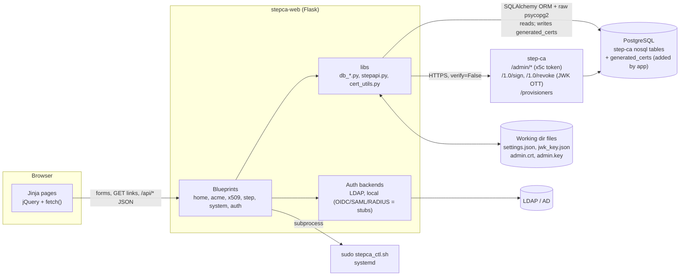
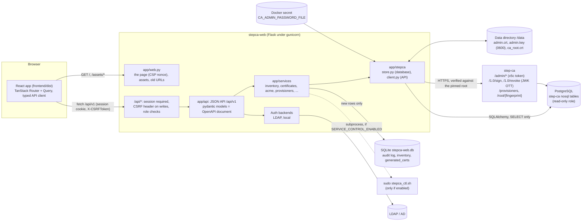

# stepca-web: Technical Analysis Report

| | |
|---|---|
| **Analysis** | 2026-10-13, revision `67caf4a` (`main`). After the history rewrite (SEC-1), the same code is commit `15c481f`. |
| **Status update** | 2026-10-29, revision `1de8a1a`. Four rounds of fixes: `21c8ab6` to `9e6e23c`, `a76538f` to `e359cf3`, `5647f08` to `db57ce4`, then `83a97d0` to `1de8a1a`. On 2026-10-30, the frontend was redesigned (see [Since `1de8a1a`](#since-1de8a1a-the-redesign)). |
| **step-ca reference** | `smallstep/certificates` at `v0.30.2-283-g69d3c36f` (local checkout `~/code/perso/certificates`) |
| **Method** | **Analysis:** I read all first-party code (39 Python files, 20 Jinja templates) and checked it against the step-ca source. I also linted it with ruff (F/B/S/E9 rules), compiled it under Python 3.11 and scanned the git history. I did **not** run the app against a live CA, so the UX findings came from reading the templates, routes and JavaScript. **Status update:** I re-checked every finding against the code at `1de8a1a`. The app now has 233 unit tests, 11 frontend unit tests, and 25 end-to-end tests against a real step-ca 0.30.2 (with an ACME client) and an OpenLDAP server, 6 of them in a browser. |

> **How to read this report.** Sections 1 to 10 keep each finding as it was found at `67caf4a`, so file and line references point at that revision. Each finding now has a status at `1de8a1a`: ✅ fixed, ⚠️ partly fixed, ❌ open. The executive summary and §11 describe the current state.

---

## Executive summary

### Status at `1de8a1a`

Four rounds of fixes addressed the findings:

- **Every security finding is fixed.**
  - No secrets in the history; login and a role for everything; CSRF protection.
  - The CA and LDAP connections verify the server's certificate.
  - Failed sign-ins are rate-limited.
  - A strict Content-Security-Policy: no inline scripts or styles (a per-response nonce covers the two style elements the frontend's dialogs add).
  - Secret and dependency scanning in CI, for the Python and the npm packages.
  - **By decision,** plain `ldap://` still works, with warnings.
- **Every correctness bug is fixed,** the 20 found in the analysis and the 4 found while testing.
- **The code structure findings are fixed:**
  - Settings are loaded by `create_app`, and every file is in one data directory.
  - One adapter reads step-ca's database into typed records, under a service layer.
  - One service owns provisioners and admins.
  - mypy checks the app in CI.
- **The scale findings are fixed** (A-7, PERF-1): the certificate lists read an inventory in the app's database, kept in step with step-ca's tables by adding only the new rows, and filter, sort and page in SQL.
- **A new frontend:** a React app (Vite, TypeScript, Tailwind, shadcn/ui, TanStack) over a JSON API with an OpenAPI document, replacing the Jinja pages and AdminLTE 3 on the end-of-life Bootstrap 4.
- **Of the 52 original findings, 49 are fixed and 3 partly fixed:** one CA identity for all users (INT-5, A-8); PostgreSQL only (INT-9). None is open.
- **The UX items are done:**
  - an ACME drill-down;
  - signing with CSR upload, preview, validity and readable errors;
  - a global search, CSV export, a loading indicator;
  - each certificate's lifetime drawn to scale, an expiry horizon, light and dark themes, phone layouts.

### Since `1de8a1a`: the redesign

The frontend now follows a design handed off as mockups (Overview, Certificates, a provisioner's settings, New certificate):

- **An overview** of active, issued, expiring and revoked certificates over 24 hours, 7 or 30 days, issuance by provisioner, the certificate that needs attention first, the authority's health, the certificates that expire next and recent activity.
- **Certificates** as tabs with counts, filter chips, multi-select (one PEM bundle, revoke together) and a detail panel beside the list.
- **New certificate** in three steps: a key made in the browser with WebCrypto (only the CSR is sent) or an uploaded CSR; then a PEM bundle, the key, or a Kubernetes TLS Secret.
- **A settings page per provisioner** whose changes are saved together, with the ACME directory URL and a cert-manager ClusterIssuer.
- **A command palette** (⌘K) for search, actions and pages.
- **ACME lists that don't slow down as renewals pile up:** step-ca never deletes ACME objects, so the ACME pages and the overview now read a copy of its ACME tables in the app's database, kept current like the certificate inventory. With 10,000 issuances, a list answers in about 25 ms instead of reading and parsing every row on each load.

Not built, because step-ca's open-source API has nothing behind them: SSH, policies, webhooks, API tokens, OCSP, EAB keys, pausing a provisioner, renewal from the UI, PKCS#12. **BUG-25** was found on the way and fixed. The app now has 253 unit tests, 15 frontend unit tests and 29 end-to-end tests, 10 of them in a browser.

**Verdict now:** fit for production as an internal admin console, behind a TLS reverse proxy with `ldaps://` or StartTLS, including for CAs with tens of thousands of certificates (§8).

### Scorecard

| Area | `67caf4a` | `1de8a1a` | What changed |
|---|:-:|:-:|---|
| 1. Architecture | 2 | **4.5** | **Improved:** typed settings loaded by `create_app`; one data directory; one adapter for step-ca's database and one client for its API, in `app/stepca`; a service layer; a JSON API whose pydantic models are its OpenAPI document; an incremental certificate inventory; step-ca's database is only read. |
| 2. Code quality | 1.5 | **4.5** | **Improved:** 233 unit tests, 11 frontend tests and 25 end-to-end tests (6 in a browser); CI with ruff, mypy, ESLint, Prettier, TypeScript, lockfile checks and scans; typed records instead of nested dicts; frontend types generated from the API; no `except Exception` left. |
| 3. Feature set | 2.5 | **4** | **Added:** revocation with a reason, certificate pages and downloads, an expiry view, roles and an audit log, provisioner editing, a CA status page with the CRL, the ACME drill-down, search, CSV export. **Missing:** SSH, policies, webhooks. EAB keys can't be made with open-source step-ca. |
| 4. UX quality | 2 | **4.5** | **Improved:** a React frontend: every object has a page and links to the related ones; lists filtered, sorted and paged by the server, kept in the URL; lifetimes drawn to scale and an expiry horizon; readable errors; dialogs for every change; light and dark themes. **Missing:** bulk actions, notifications. |
| 5. step-ca integration | 2.5 | **4** | **Improved:** correct serials, pinned TLS, full pagination, a dedicated ADMIN identity, the key decrypted in memory, version check, CRL, tests against a real step-ca with ACME. **Still missing:** PostgreSQL is the only supported database. |
| 6. Security | 1 | **4.5** | **Improved:** everything in SEC-1 to SEC-13, and a strict CSP. **Still open:** cleartext LDAP is allowed (by decision); one CA identity for all users. |

### Finding status

| Area | ✅ Fixed | ⚠️ Partly fixed | ❌ Open | Found while re-checking |
|---|:-:|:-:|:-:|---|
| Security (SEC-1 to SEC-12) | 12 | 0 | 0 | SEC-13 (Low), fixed |
| step-ca integration (INT-1 to INT-10) | 8 | 2 | 0 | |
| Correctness (BUG-1 to BUG-20) | 20 | 0 | 0 | BUG-21 to BUG-25 (Low), fixed |
| Architecture (A-1 to A-9) | 8 | 1 | 0 | |
| Performance (PERF-1) | 1 | 0 | 0 | |
| **Total (52)** | **49** | **3** | **0** | **6, all fixed** |

Appendix B lists every finding with its status. §11 orders what is left.

### What is left, most important first

| ID | Severity | What remains |
|---|---|---|
| [INT-5](#int-5-medium-every-web-user-acts-as-the-same-ca-super-admin) / A-8 | Medium | All users act on the CA as one identity (an ADMIN, in the recommended setup), which can still create provisioners. step-ca's logs can't name the user; the app's audit log does. |
| [SEC-6](#sec-6-high-cleartext-and-unverified-transport) | Low (by decision) | `ldap://` without StartTLS still works, with warnings. |
| [INT-9](#int-9-medium-coupling-to-step-cas-database) | Low | PostgreSQL is the only database step-ca can use with this app. |

### Original assessment (`67caf4a`)

stepca-web is a Flask + AdminLTE admin console for a [step-ca](https://github.com/smallstep/certificates) instance that uses PostgreSQL and has remote management (`enableAdmin`) turned on.

- **Reads:** it reads step-ca's internal key/value tables directly from the database to list certificates, ACME objects, provisioners and admins.
- **Writes:** it acts through step-ca's Admin API, using an x5c admin token. It signs and revokes through `/1.0/sign` and `/1.0/revoke`, using a JWK one-time token.
- **Host control:** it can start and stop the CA's systemd service through `sudo`.

**Strengths.** The protocol work is good. The app builds step-ca-compatible x5c admin tokens. It decrypts PBES2-encrypted provisioner keys. It mints JWK one-time tokens (OTTs). It generates JWK provisioners that step-ca accepts. Doing all this in Python without an SDK requires a real understanding of step-ca internals.

**Weaknesses.** Everything around that core is still at prototype level. One core operation, revocation, silently does the wrong thing. Several advertised features are broken or missing. The security posture is far below what a component holding **CA super-admin credentials and a plaintext provisioner signing key** needs.

**Verdict at `67caf4a`:** a promising proof of concept that was **not safe to expose on any network**. The architecture is fine for an admin tool of this size. Most problems could be fixed incrementally, and a rewrite was not needed. The status update confirms this: the findings were fixed without a rewrite.

#### Top findings at `67caf4a`

| ID | Severity | Finding | Status at `1de8a1a` |
|---|---|---|---|
| [SEC-1](#sec-1-critical-secrets-in-public-git-history) | Critical | The public GitHub history contains a **decrypted admin JWK private key**, two private keys and a `settings.json` with the DB password. | ✅ |
| [SEC-2](#sec-2-critical-15-of-26-routes-have-no-authentication) | Critical | 15 of 26 functional routes are unauthenticated. Anyone who can reach the app can **create a SUPER_ADMIN, delete provisioners or admins, and stop the CA**. | ✅ |
| [INT-1](#int-1-critical-revocation-revokes-a-serial-that-does-not-exist) | Critical | Revoking from the UI records a **non-existent serial** in step-ca, so the real certificate stays valid. The UI still shows it as revoked, which hides the problem. | ✅ |
| [SEC-3](#sec-3-high-werkzeug-debug-server-is-the-production-entrypoint) | High | `app.run(debug=True, host="0.0.0.0")` is the Docker `CMD`. | ✅ |
| [SEC-4](#sec-4-high-no-csrf-protection-destructive-get-endpoints) | High | There is no CSRF protection anywhere, and delete actions are plain GET links. | ✅ |
| [INT-2](#int-2-high-revocation-status-is-computed-with-the-wrong-encoding) | High | Certificates revoked with `step ca revoke`, through ACME or over mTLS are shown as **Active**. | ✅ |
| [INT-4](#int-4-high-tls-verification-disabled-root-fingerprint-unused) | High | TLS verification is off for all CA traffic (`verify=False`), and the configured root fingerprint is never used. | ✅ |
| [PERF-1](#8-performance-and-scalability) | High | Listing certificates is O(N²) in database rows, and the dashboard does it three times per view. | ⚠️ O(N) now |
| [INT-3](#int-3-medium-admin-api-pagination-ignored-silent-truncation-at-20) | Medium | Admin API pagination is ignored. Only the first 20 provisioners and 20 admins are ever shown or usable. | ✅ |
| [BUG-13](#23-correctness-bugs) | Medium | ACME provisioner creation is blocked by a hidden `required` field. Admin "Edit" creates duplicates. Several buttons do nothing. | ✅ |

---

## 1. Architecture

### 1.1 Context and prerequisites

To work, the app needs:

- step-ca with **PostgreSQL** as its database and **remote management** enabled (`authority.enableAdmin: true`, i.e. `step ca init --remote-management`).
- `jwk_key.json` in the working directory: the **decrypted** private JWK of the "Admin JWK" provisioner. Per the README, this is produced with `step crypto jwe decrypt`.
- `settings.json` in the working directory: DB credentials, CA URL and root fingerprint.
- For service control: a sudoers rule plus `/usr/local/bin/stepca_ctl.sh`. Neither is in the repo or documented.
- An LDAP/AD server (the default auth backend), or local users hard-coded in source.

**At `1de8a1a`:**
- **step-ca:** PostgreSQL and remote management are still required. A **read-only** database role is enough.
- **Admin key:** `jwk_key.json` is replaced by `CA_ADMIN_PASSWORD_FILE`, the password of the app's own provisioner (in Docker, a secret file). The app decrypts that provisioner's key in memory. `jwk_key.json` still works as a legacy fallback and logs a warning.
- **Configuration:** comes from environment variables (`.env.example` documents them), and `settings.json` is optional. `SECRET_KEY`, `CA_URL` and `DATABASE_HOST` are required.
- **Service control:** off unless `SERVICE_CONTROL_ENABLED=true`. When on, it needs a script and a sudoers rule, which the README gives.
- **Users:** LDAP, or local users from `local_users.json` with a role each.

### 1.2 Component view

At `67caf4a`:



At `1de8a1a`:



### 1.3 Code organisation

| Layer | Location | Responsibility | Notes at `67caf4a` | At `1de8a1a` |
|---|---|---|---|---|
| Entry and config | `run.py`, `config.py` | Start the dev server; load `settings.json`, with env override | Config is read **at import time** (`config.py:9`) | `app/settings.py`: typed settings (environment, then settings.json, then defaults), loaded by `create_app`. Nothing is read at import. |
| App factory | `app/__init__.py` | Register 8 blueprints; create the `generated_certs` table | Runs DDL against the CA database at startup (`app/__init__.py:23-26`) | Creates only the app's own SQLite tables; registers the API and the frontend; installs the session check, CSRF and the CSP. Refuses to start without the required settings. |
| Routes | `app/blueprint/{home,acme,x509,step,system,auth}` | HTML views plus two small JSON APIs (`/api/acme/*`, `/api/x509/*`) | Business logic lives in the route functions | `app/api/`: one JSON API under `/api/v1`, its pydantic models exported as `frontend/openapi.json`. Routes only do HTTP; the domain rules are in `app/services/`. `app/web.py` serves the frontend. |
| Data access | `app/libs/db_*.py`, `app/models/*.py` | Decode step-ca's key/value tables | **Two mechanisms:** SQLAlchemy ORM (X.509, ACME) and raw psycopg2 with a connection per call (provisioners, admins) | `app/stepca/store.py`, the one module that knows step-ca's tables, returns typed records (`app/stepca/records.py`). SQLAlchemy only, read-only. |
| CA client | `app/libs/stepapi.py` (535 lines) | Admin API, sign, revoke, JWK generation | One large class plus a `CAToken` helper | `app/stepca/client.py`, built by `create_app` from the settings and stored in `app.extensions`. |
| Crypto helpers | `app/libs/cert_utils.py` | Parse certificates and CSRs | Two near-duplicate parsers | One parser, plus readable extensions and step-ca's provisioner extension |
| Auth | `app/auth/`, `app/libs/auth/` | Backend factory and `login_required` | Only LDAP and local are implemented | Adds the session check for every API request (`decorator.py`) and roles (`roles.py`) |
| UI | `app/templates/`, `app/static/` | AdminLTE 3 / Bootstrap 4 / jQuery | 1,891 vendored static files (65 MB), about 6 of them used | `frontend/`: React and TypeScript, 44 source files and 19 shadcn/ui components, built by Vite into about 250 kB of gzipped JavaScript, split per page. Nothing is vendored. |

### 1.4 Main flows

1. **Read path** (for example, *Active certificates*): `db_x509.get_x509_active_certs()` loads every row of `x509_certs`. For each row it then loads **every** row of `x509_certs_data` to find the matching provisioner (`db_x509.py:19,43-52`). It then loads every revoked row, parses each DER certificate with `cryptography`, filters by date and renders all of them, with no pagination.
   **Now:** the lists read the inventory in the app's database, which each read first brings up to date (new rows only, at most every 5 seconds). Filters, sort and page are SQL; the browser receives one page of JSON.
2. **Admin write path** (for example, *create admin*): `StepCAClient._request()` calls `_get_jwt_token()`. If `admin.crt` is missing or has less than 1 hour left, the client generates a P-256 key and CSR. It then signs an OTT with the plaintext `jwk_key.json`, calls `/sign` and **writes `admin.crt` and `admin.key` to the working directory** (`stepapi.py:143-201`). Finally it builds an x5c JWT (`iss=step-admin-client/1.0`, `aud=<request URL>`) and calls `/admin/...`.
   **Now:**
   - The certificate is also renewed when it was issued to another subject or by another provisioner.
   - Renewal holds a file lock.
   - The key is written first, with mode `0600`, and both files are replaced atomically.
   - The admin key comes from memory.
   - Requests are verified against the pinned root.
   - The token audience is the request URL without its query string.
3. **Sign and revoke path:** the user types a provisioner passphrase. The app fetches `/provisioners`, decrypts the provisioner's `encryptedKey` (PBES2 JWE) in memory, mints a JWK OTT and posts it to `/1.0/sign` or `/1.0/revoke`. Signed certificates and their CSRs are also stored in `generated_certs`.
   **Now:**
   - **Sign:** unchanged, except that `generated_certs` is in SQLite.
   - **Revoke:** asks for no passphrase. It uses the app's own provisioner key, sends the decimal serial and the chosen reason, and is recorded in the audit log.
4. **Service control:** `POST /step/service/<action>` runs `sudo /usr/local/bin/stepca_ctl.sh <action>` (`step/routes.py:120`).
   **Now:** returns 404 unless `SERVICE_CONTROL_ENABLED=true`. It needs the admin role, has a 60 s timeout and is audited.

### 1.5 Trust boundaries and secrets held

| Secret | Where it lives | What it grants | At `1de8a1a` |
|---|---|---|---|
| DB credentials | `settings.json` (plaintext) or env vars | Read **and write** access to step-ca's DB. The app needs CREATE privilege for `generated_certs`. Write access means one can forge revocations, edit provisioners and so on. | Env vars (or `settings.json`). A role with SELECT only is enough. |
| Admin JWK private key | `jwk_key.json` (plaintext) | Signs **any certificate** that the "Admin JWK" provisioner allows, and mints super-admin x5c certificates. | Decrypted in memory from `CA_ADMIN_PASSWORD_FILE`. It is the key of the app's own provisioner, and the README recommends an ADMIN rather than a SUPER_ADMIN identity. |
| Admin x5c cert and key | `admin.crt`, `admin.key` (working dir, default umask) | SUPER_ADMIN on the Admin API as subject `step`, for 24 h at a time. | `admin.key` is `0600`. The identity is `CA_ADMIN_SUBJECT` (README: `stepca-web`, type ADMIN). |
| Provisioner passphrases | Typed per operation | Decrypt provisioner keys inside the web process. One of them is printed to stdout (SEC-7). | Typed only to sign. Never logged. |
| Flask `SECRET_KEY` | Env var, otherwise random per process | Forging sessions. | Required: the app does not start without it. |
| sudo rule | `/etc/sudoers` (not in repo) | Start and stop the CA. | Only used when service control is enabled |

**Key insight:** stepca-web is a **tier-0 component**. It holds a super-admin identity, a plaintext signing key, write access to the CA's database and control over the CA process. Compromising the web app is equivalent to compromising the CA's issuance policy, so it needs at least the same protection as the CA itself.

**At `1de8a1a`** the app is still tier-0, but a smaller one. It holds an ADMIN identity (not SUPER_ADMIN) and its provisioner key only in memory, and it only reads the CA's database. An ADMIN can still create provisioners, and so can still issue certificates.

### 1.6 Assessment

**Strengths**
- The app factory plus one blueprint per domain is a clean and familiar Flask layout. A newcomer can find things quickly.
- The data-access, CA-client and route layers are roughly separated.
- The auth backend factory (`app/auth/factory.py`) is a sensible extension point.
- Server-rendered Jinja suits a low-traffic admin tool. The codebase is small enough to reason about as a whole.

**Weaknesses**

| ID | Issue | Consequence | Status at `1de8a1a` |
|---|---|---|---|
| A-1 | **Side effects at import time:** `config.py` opens `settings.json` and prints; three blueprint modules each create a `StepCAClient` at import (`step/routes.py:9`, `x509/routes.py:12`, `system/routes.py:8`, where it is unused), and each reads `jwk_key.json`. `create_app` runs DDL. | The app can't be imported without real files and a database, so it can't be unit-tested. Config edits need a restart (BUG-16). | ✅ **Fixed** (`1114520`): settings are loaded by `create_app` (`app/settings.py`), the CA client is built there, and nothing reads the environment or a file at import. Tests pass their own settings. |
| A-2 | **Two DB stacks and two configs:** SQLAlchemy uses `SQLALCHEMY_DATABASE_URI`, while psycopg2 uses `DB_*`. psycopg2 opens a new connection per call, without pooling, and doesn't close it on exceptions. | The two stacks can point at different databases. Connections can leak. | ✅ `db_conn.py` is gone. Everything goes through SQLAlchemy with psycopg 3 (`9ab380e`). |
| A-3 | **Two sources of truth for provisioners:** the Admin API (provisioner page) and direct DB reads (`get_step_provisioners`, used for maps, dropdowns and the dashboard). | The two can disagree, for example on pagination or deleted items. | ✅ **Fixed** (`7b5475d`): `app/services/provisioners.py` is the one place for both. Lists and changes come from the Admin API; the database only fills in what the API leaves out (provisioner ids, some admins' creation dates) and serves pages that don't call the CA. |
| A-4 | **The app writes its own table into step-ca's database** (`generated_certs`). | The app needs CREATE on the CA's database and can't run with a read-only role. The table is also redundant, because `x509_certs` already stores the DER of every certificate. | ✅ App data is in SQLite (`21c8ab6`, `f6b09ce`). Downloads read `x509_certs`. The end-to-end tests run the app on a SELECT-only role. |
| A-5 | **No service layer.** Domain rules (what counts as "active") and presentation (`not_before_pretty`) are mixed into data functions. | Hard to test, and hard to reuse in an API. | ✅ **Fixed** (`7b5475d`): `app/services/` holds the rules (active, expiring, misdirected revocations, certificate status and downloads, dashboard, search, CA status); routes parse, call a service and render. |
| A-6 | **Coupled to step-ca's internal storage format** (nosql key/value tables and Go JSON field names). | This is unavoidable for listing certificates, since open-source step-ca has no list-certificates API. It should be isolated in one adapter with fixture-based tests. Today the knowledge is spread out, and part of it is wrong (INT-1, INT-2). | ✅ **Fixed** (`5647f08`, `7b5475d`): `app/stepca/store.py` is the only code that knows step-ca's tables and field names; it returns typed records, tested on rows in step-ca's format and end to end. |
| A-7 | **Synchronous full-table reads on every page view**, with no caching. Certificates are immutable, so they are ideal to cache. | See §8. | ✅ **Fixed** (`83a97d0`): the inventory (`app/services/inventory.py`) keeps parsed certificates and revocations in the app's database. |
| A-8 | **One shared CA identity** (`step`) for every web user. | No attribution in step-ca's logs and no least privilege (INT-5). | ⚠️ **Fixed:** a dedicated identity (`CA_ADMIN_SUBJECT`), and the app's audit log names the user. **Still there:** step-ca's own logs show one subject for every user. |
| A-9 | **State in the working directory** (`settings.json`, `jwk_key.json`, `admin.crt`/`admin.key`, all relative paths). | Behaviour depends on where the process starts. Multiple workers race on the admin certificate (BUG-17). | ✅ **Fixed** (`1114520`): every file is in `DATA_DIR` (`/data` in the images); relative file settings are relative to it. The unit tests run from `/` to prove nothing uses the working directory. |

### 1.7 Recommended target architecture (incremental)

- **Config:** load settings once in `create_app` from env or a file, for example with `pydantic-settings`. No I/O at import time. Make config read-only in the UI, or reload it explicitly. *Status:* ✅ pydantic-settings, loaded by `create_app`; the config page is read-only.
- **CA client:** a single `StepCAClient` built in `create_app` and stored in `app.extensions`. It should use a `requests.Session` with the **pinned root** (bootstrapped from the fingerprint, see INT-4), timeouts and retries. Load secrets from a secret store, or keep the key encrypted at rest. *Status:* ✅ built in `create_app`, in `app.extensions`, with the pinned root, 30 s timeouts and the key decrypted from a secret file. It doesn't use a `Session` or retry.
- **Data access:** one read-only SQLAlchemy engine for step-ca's tables, behind a `StepDBRepository`. The repository should own the step-ca encoding rules (serial key = decimal ASCII) and return typed dataclasses. *Status:* ✅ `app/stepca/store.py`, returning `app/stepca/records.py` dataclasses.
- **App state:** the app's own data (audit log, users and roles, metadata about issued certificates, cached inventory) belongs in a **separate** database or schema, managed with migrations (Flask-Migrate/Alembic). *Status:* ⚠️ the app has a separate SQLite database (`APP_DATABASE_URI` can point elsewhere) holding the audit log, the certificate inventory and `generated_certs`. Tables are created with `create_all`; there are no migrations yet.
- **Service control:** keep a tightly scoped sudoers rule, or remove the feature and leave CA lifecycle to systemd or Kubernetes. It doesn't work inside the provided container anyway. *Status:* ✅ opt-in, off by default.
- **UI:** keep server-side rendering. Add DataTables, which is already vendored, or HTMX for interactivity. At this size a SPA rewrite would mostly add cost. *Status:* replaced, against this advice, by a React frontend over a JSON API (`1de8a1a`). The service layer made the API cheap, and the owner wanted a current UI on maintained libraries. The server filters, sorts and pages; the strict CSP stays.

---

## 2. Code quality

### 2.1 Metrics

| Metric | `67caf4a` | `1de8a1a` |
|---|---|---|
| First-party Python | 39 files, 2,106 lines (about 1,440 SLOC). 243 comment lines, mostly **commented-out code**. | 41 files, 4,604 lines: the JSON API, the services, the step-ca adapter. Commented-out blocks removed. |
| Templates | 20 files, 2,412 lines | None: the frontend is 44 TypeScript files (about 4,900 lines) and 19 shadcn/ui components |
| Vendored front-end | 1,891 files, 65 MB, 60 AdminLTE plugin packages, about 6 of them used | None: 18 runtime and 24 build npm packages, locked in `frontend/package-lock.json` |
| Automated tests | **0** | 233 unit tests (about 2,200 lines), 11 frontend unit tests (Vitest), and 25 end-to-end tests against step-ca 0.30.2 on PostgreSQL (with an ACME client) and an OpenLDAP server, 6 of them in headless Chromium |
| CI, linter, type-checker, pre-commit config | **None** | GitHub Actions runs ruff, mypy, the unit tests, lockfile checks, ESLint, Prettier, TypeScript, Vitest and the frontend build, checks that the OpenAPI document and the generated types are current, and runs the end-to-end tests with both Dockerfiles; a security workflow runs gitleaks, pip-audit and npm audit on every push and weekly. Pre-commit runs gitleaks, ruff, mypy and the frontend checks. |
| Dependency manifest | `requirements.txt` with 16 **unpinned** entries and no lockfile. 5 are unused (`flask-login`, `flask_wtf`, `authlib`, `psutil`, `protobuf`). `gunicorn` is installed but never used. | `pyproject.toml` (15 direct dependencies) + `uv.lock`; `requirements.txt` exported with hashes; `frontend/package-lock.json`; gunicorn is the server |
| Logging | 73 `print()` calls (many with emojis) and no `logging` | `logging` only, with no `print()` left. Audit events go to the `stepca_web.audit` logger. |
| ruff (`F,B,S,E9`) | 36× F405 + 13× F403 (star imports), 8× F401 unused imports, 7× F811 redefinitions, 4× S113 requests without timeout, 4× F541, 3× F841, plus S104, S110, S311, S501, S603, S607 | Clean on the CI rule set (`E4,E7,E9,F,I,UP,B`). No star imports, and every request has a timeout. |
| Python version | **Requires 3.12+.** `step/routes.py:62,64` reuses the same quote character inside f-strings (PEP 701), which fails on 3.11 with `SyntaxError: f-string: unmatched '['`. I verified this. The README says "Python 3.9+". | `requires-python = ">=3.12"`; the README says 3.12+ |

### 2.2 Strengths

- Database access uses the ORM or parameterised SQL (`db_jwk.py`), so I found no SQL injection.
- `subprocess` gets a fixed argv list and the action is checked against an allow-list (`step/routes.py:116-120`), so there is no shell injection.
- Jinja autoescaping protects all server-rendered output.
- Local passwords use Werkzeug's scrypt hashing.
- The cryptographic code uses well-established libraries (`cryptography`, `jwcrypto`) and does not hand-roll primitives.

### 2.3 Correctness bugs

All 20 are fixed, mostly in `89b419e`, with BUG-8 also in `f6b09ce` and BUG-16 in `763da5a`. Unit or end-to-end tests cover most of them. BUG-21 to BUG-25 were found while re-checking and testing, and are fixed too.

| ID | Location | Defect | Effect | Status at `1de8a1a` |
|---|---|---|---|---|
| BUG-1 | `app/blueprint/step/routes.py:18-61` | `resp` is only assigned inside two independent `if` branches | Any other `type` value raises `UnboundLocalError` (HTTP 500) | ✅ An unknown type shows an error message |
| BUG-2 | `step/routes.py:66-67`, `stepapi.py:285-287` | `list_provisioners()` returns `None` on error, and the route then indexes it | Any CA or API error gives HTTP 500 instead of an error message | ✅ Shows "Could not load the provisioners" |
| BUG-3 | `stepapi.py:176-183` | `data` is undefined when `/sign` does not return 201 | Failure to bootstrap the admin certificate raises `UnboundLocalError`, which hides the real CA error | ✅ Raises with step-ca's status and message |
| BUG-4 | `stepapi.py:389-390` | `list_admins()` ignores the HTTP status | An error body crashes the template with a `KeyError` | ✅ Returns `None` on error, and the page shows a message |
| BUG-5 | `stepapi.py:429-440` | `public_get_provisioner_by_name` returns `None` when the provisioner isn't found, and only searches the first page (INT-3) | Sign or revoke shows `'NoneType' object is not subscriptable` to the user | ✅ Searches every page and raises "Provisioner '…' not found on the CA" |
| BUG-6 | `stepapi.py:496-498` | `health()` uses `self.url` and `self.cert_bundle_fn`, which don't exist | Broken (also dead code) | ✅ Removed |
| BUG-7 | `stepapi.py:55-69` | `CAToken.decrypt_and_merge` calls `jose.jwk.JWK.from_password`, which doesn't exist | Broken duplicate of `stepapi.py:521` | ✅ Removed, along with python-jose |
| BUG-8 | `x509/routes.py:43-45` | `url_for("x509/x509.active_certs")` is not a valid endpoint, and the flash message prints `None` | Downloading an unknown serial raises `BuildError` (HTTP 500) | ✅ Redirects with "Certificate … not found". Downloads now work for every certificate. |
| BUG-9 | `db_x509.py:19-22` | A certificate with no `x509_certs_data` row raises `TypeError` | A valid certificate is shown as `[error decoding cert]` | ✅ Listed, with no provisioner |
| BUG-10 | `db_x509.py:125` | A revoked row that failed to parse has no `"Serial"` key | One bad row breaks both the *Active* page and the dashboard | ✅ Revoked serials come from the table keys |
| BUG-11 | `templates/step/admin.html:170` + `step/routes.py:81-94` | The *Edit admin* form posts to the **create** handler, and `admin_id` is ignored | "Edit" creates a **duplicate** admin | ✅ Edit changes the admin's type through `PATCH /admin/admins/{id}`, the only field step-ca lets you change |
| BUG-12 | `templates/step/provisioners.html:262-267` | The *Save* handler only calls `console.log` | Editing a provisioner does nothing | ✅ The dead form is replaced by a read-only view. Editing is a missing feature (§3.3). |
| BUG-13 | `templates/step/provisioners.html:210-214` | The passphrase field is `required` inside a `display:none` block, and ACME is the default type | The browser refuses to submit, so **ACME provisioners cannot be created** | ✅ Only the selected type's fields are shown, required and submitted. Checked in a browser. |
| BUG-14 | `templates/x509/all_certs.html:75,79` | `loadX509Cert` isn't defined on this page, and *revoke* links to `GET /x509/revoke/<id>`, which doesn't exist | The view and revoke buttons on *All* are dead (JS error, then 404) | ✅ Every list links to the certificate page, which can revoke |
| BUG-15 | `templates/acme/orders.html:84` | `loadCert()` and `#certModal` don't exist | The order "View" certificate link is dead | ✅ Links to the certificate page |
| BUG-16 | `system/routes.py:26-42` | Writes `settings.json`, but config is only read once at import | The UI says "updated successfully" but nothing changes until restart | ✅ The config page is read-only and shows the settings in effect, with secrets masked |
| BUG-17 | `stepapi.py:186-199`, `stepapi.py:203-206` | Any worker rewrites `admin.crt` and `admin.key` non-atomically when the certificate is close to expiry | With several gunicorn workers, a request can load a mismatched cert and key | ✅ File lock around renewal and reading; atomic writes, key first |
| BUG-18 | `config.py:51-53` | `SECRET_KEY` is random per process when unset | Sessions are lost on every restart, and with N workers users get logged out at random | ✅ Required at startup |
| BUG-19 | `templates/home/index.html:218` | `cert.provisioner.name` throws for entries without a `provisioner` key (the BUG-9 error rows) | The whole "issuance" bar chart fails to render | ✅ Every entry has a `provisioner` object, and the chart has an empty state |
| BUG-20 | `blueprint/acme/api.py`, `blueprint/x509/api.py` | Empty lists return **404** | The dashboard charts break on a fresh CA. The REST semantics are also wrong. | ✅ Empty lists return `[]` |
| **BUG-21** (new, Low) | `app/templates/*` | Flash messages are rendered on only 7 pages. *All*, *Expiring*, *Revoked*, the ACME pages and the dashboard don't render them. | For example, `/x509/cert/<unknown serial>` redirects to *All* with "Certificate … not found". *All* doesn't show it, so the message appears on whichever page renders flashes next. | ✅ Every page includes `includes/flashes.html` (`4903a97`) |
| **BUG-22** (new, Low) | `app/libs/auth/ldap_backend.py` | The user search asks for `*`. OpenLDAP treats `memberOf` as operational and only returns it when asked for by name | On OpenLDAP, users never get the role of their groups, only `DEFAULT_ROLE` | ✅ `memberOf` is requested by name. Tested against OpenLDAP (`36f1d27`) |
| **BUG-23** (new, Low) | `app/libs/stepapi.py` | Provisioner names are put in Admin API paths unescaped. step-ca checks the token audience against the decoded path | Deleting a provisioner whose name has a space or a `/` fails | ✅ Names are escaped. The end-to-end test edits and deletes "e2e edit" (`85c1a55`) |
| **BUG-24** (new, Low) | `home/index.html`, `tables.js` | The dashboard's bar chart draws its labels below its SVG area, which clips them. `tables.js` hides its paging bar with `style.display`, which Bootstrap's `d-flex !important` overrides | The chart has no provisioner names; every list shows a paging bar, even with 3 rows | ✅ Both fixed (`4903a97`), checked in a browser |
| **BUG-25** (new, Low) | `app/services/provisioners.py` | step-ca's `GET /admin/provisioners` answers in its older JSON (`maxTLSCertDuration`, ACME settings at the top level), not the linkedca JSON of `GET /admin/provisioners/{name}` that `summary()` read | The provisioner list showed every lifetime as the CA's default and every ACME provisioner as allowing all challenges; the signing dialog then capped validity at 24 hours | ✅ Both shapes are read, and the creation date comes from step-ca's database; a unit test uses the list's real shape |

### 2.4 Maintainability issues

- ✅ **Star imports everywhere** (`from app.libs.db_acme import *` and others). `system/routes.py` only works because `os` and `json` leak in through `from app.libs.stepapi import *`. *All imports are now explicit.*
- **Duplication:**
  - ✅ `parse_cert` and `parse_cert_from_bytes` are about 80% identical. *One parser now; `parse_cert` decodes the ACME leaf and calls it.*
  - ✅ `decrypt_and_merge` exists twice. *One copy left.*
  - ✅ The flash-message block is copied into 5 templates. *Fixed in the second round with one partial; the templates are gone since, and the frontend shows messages as toasts and inline alerts.*
  - ✅ Every template re-declares the font, Font Awesome and AdminLTE CSS links that `base.html` already loads, so `adminlte.min.css` loads twice per page. *Fixed with one base layout; the templates are gone since: Vite builds one stylesheet and per-page scripts.*
- ✅ **Dead code** is removed:
  - `models/post.py` and `models/question.py` (leftovers from a Flask tutorial).
  - `db_jwk.py` and `db_init.py` (the `jwk_keys` table is no longer used).
  - Unused functions: `decode_certificate`, `get_subject_string`, `update_provisioner`, `get_step_admins`, `get_acme_cert_by_id`, `get_x509_certs_data`, `_save_tempfile`. `_compare_fingerprints` is now used to pin the root.
  - `_page_template.html`.
  - About 170 lines of commented-out code in `db_acme.py` and `system/routes.py`.
- ✅ **Error handling:**
  - **Then:** broad `except Exception: print(...)` that swallows errors, and raw exception text shown to users (`Failed to sign certificate with error …`).
  - **Now:** each call catches the errors it can raise; no `except Exception` is left. Signing explains wrong passwords, invalid CSRs and step-ca's refusals in words.
- ✅ **Three JOSE libraries** (python-jose, PyJWT, jwcrypto) for one job. python-jose has had little maintenance and a history of CVEs. Standardise on `jwcrypto`, which is already required for the JWE work. *python-jose is removed. PyJWT signs the tokens and jwcrypto handles the JWE.*
- ✅ **Four `requests` calls without a timeout**, so a hung CA ties up worker threads indefinitely. *Every call has a 30 s timeout.*
- ✅ **Deprecated date handling:** `datetime.utcnow()` and `utcfromtimestamp()` are deprecated in 3.12, and `pytz` is unnecessary. *The code uses `datetime.UTC`, and pytz is removed.*
- ✅ **Weak typing:** almost no type hints, and nested dicts are passed to templates (`cert["data"]["provisioner"]["name"]`). *Typed records go to the templates, and mypy checks every function body in CI.*
- ✅ **Typos that reach the UI:** "Provisionner" (×3), "Name111", "ACMECertificates". *Fixed.*

### 2.5 Recommendations

1. ✅ Move to `pyproject.toml` + `uv.lock` and pin everything. Remove the unused dependencies and python-jose.
2. ✅ Add `ruff` (lint and format) and `pyright` or `mypy`, enforced with pre-commit and GitHub Actions. *ruff and mypy, in both.*
3. ✅ Replace `print` with `logging`, and add a rule that secrets and tokens are never logged.
4. ✅ Remove the dead code, the commented-out blocks and about 98% of the vendored assets.
5. ✅ Add tests (see §9).

---

## 3. Feature set

### 3.1 What the README claims vs. what the code does

| Advertised feature | Status at `67caf4a` | Notes at `67caf4a` | At `1de8a1a` |
|---|---|---|---|
| ACME: "list **and manage**" accounts, orders, certs, authorizations, challenges | ⚠️ Read-only, partial | Flat lists only. No deactivation and no links between related objects. The order → certificate link is broken (BUG-15). The pages are unauthenticated (SEC-2). | ⚠️ Still read-only, by design, now with a page per account and per order linking orders, authorizations, challenges and certificates. |
| X.509: valid and revoked certificates with details and provisioners | ⚠️ Partial | The lists work. Revoked status is wrong for revocations made outside the UI (INT-2). The details modal only works on *Active*. | ✅ Correct revoked status, with the reason. Every certificate has a page with its extensions and PEM, chain and DER downloads. New *Expiring* list (7, 30 or 90 days). |
| SSH certificate management | ❌ Missing | No code reads `ssh_certs` or `revoked_ssh_certs`. | ❌ Still missing; no longer advertised |
| Provisioners: list, add, delete (JWK/ACME) | ⚠️ Partial | The list is capped at 20 (INT-3). Adding a JWK provisioner works. Adding an ACME provisioner is blocked (BUG-13). Edit does nothing (BUG-12). Delete works, but as an unauthenticated GET. | ✅ Every provisioner is listed. JWK and ACME can be added, and edited: durations, renewal options, ACME challenges, force CN, require EAB. Delete is a POST that needs the admin role. |
| Admin users: view and manage | ⚠️ Partial | List (capped at 20), create and delete work. Edit creates a duplicate (BUG-11). | ✅ List, create, delete and type change. Read-only when the app's identity is an ADMIN, because only a SUPER_ADMIN may manage admins. |
| "Step CA Config Editor: edit and validate `ca.json` with JSON syntax highlighting" | ❌ Not implemented | `/system/config` edits the **app's own** `settings.json` (DB credentials and CA URL). There is no `ca.json` editing and no syntax highlighting. | ✅ The claim is gone from the README. `/system/config` is a read-only view of the app's effective settings. |
| Systemd service control | ⚠️ Works, with external prerequisites | Needs an undocumented sudoers rule and `stepca_ctl.sh`. Unauthenticated. Can't work in the Docker image. | ✅ Opt-in, admin role, audited, with confirmations. The README gives a script and a sudoers rule limited to it. Still can't work in a container, by nature. |
| Dashboard KPIs | ✅ Works | Expensive (§8). The "Certificate Issuance" chart is actually *certificates per provisioner*, over all time. | ✅ Adds an "expiring within 30 days" tile. The charts use the counts the server already has. |
| Sign a CSR | ⚠️ Works for JWK only | ACME provisioners are offered but can't work. Template data is hard-coded (INT-7). Validity can't be chosen. | ✅ Pasted or uploaded, previewed, with a chosen validity, JWK provisioners only, readable errors. Needs the operator role. |
| Revoke | ❌ **Broken** | Revokes the wrong serial (INT-1). The reason is always keyCompromise (INT-8). | ✅ Correct serial, reason chosen from a list, no passphrase, operator role, audited. Tested end to end: step-ca refuses to renew the revoked certificate. |
| Download a certificate | ⚠️ Partial | Only for certificates signed through this UI (from `generated_certs`). | ✅ Any certificate, from `x509_certs`, as PEM, chain or DER |
| Auth backends: LDAP, RADIUS, SAML, OIDC, local | ⚠️ Partial | Only LDAP and local are implemented. The other three are stubs that always fail. The README to-do still says "Add user authentication". | ✅ The stubs are gone. LDAP (with LDAPS or StartTLS, certificate verified) and local users, each with a role. |

### 3.2 Coverage of step-ca's capabilities

| step-ca capability | Interface | stepca-web at `67caf4a` | At `1de8a1a` |
|---|---|---|---|
| X.509 inventory | DB only (no API) | ✅ List and detail | ✅ Plus the certificate page and the expiring list |
| Sign with a JWK OTT | `POST /1.0/sign` | ✅ | ✅ |
| Revoke | `POST /1.0/revoke` | ❌ Broken (INT-1) | ✅ With a reason |
| CRL | `GET /crl` | ❌ | ✅ Shown on the status page, downloadable as DER or PEM |
| Health, version, roots, federation | `GET /health`, `/version`, `/roots`, `/federation` | ❌ (only `systemctl status`) | ✅ Status page: health, version (checked at startup), roots and intermediates with their expiry. No federation. |
| SSH certificates (inventory, revoke, hosts) | DB + `/1.0/ssh/*` | ❌ | ❌ |
| Provisioners CRUD | `/admin/provisioners` | ⚠️ Create (JWK/ACME), read (≤ 20), delete. Update is missing (`update_provisioner()` exists but is never called). | ✅ Create (JWK/ACME), read (all), update (`PUT`), delete |
| Other provisioner types: OIDC, X5C, K8sSA, SSHPOP, SCEP, Nebula, AWS/GCP/Azure | `/admin/provisioners` | ❌ | ❌ |
| Claims (renewal, SSH durations, `disableRenewal`, …), x509/ssh templates, options | `/admin/provisioners` | ❌ (only x509 default/min/max durations) | ⚠️ X.509 durations and renewal options; no SSH claims, templates or options |
| Admins CRUD | `/admin/admins` | ⚠️ Create, read (≤ 20), delete. `PATCH` is missing. | ✅ Create, read (all), type change (`PATCH`), delete |
| ACME External Account Binding keys | `/admin/acme/eab/*` | ❌ So "Require EAB" provisioners can't be used from the UI. | ❌ Not possible with open-source step-ca: its Admin API answers 501, only Certificate Manager can create EAB keys. The forms warn about it. |
| Policies (authority, provisioner, ACME account) | `/admin/policy`, `/admin/provisioners/{p}/policy`, `/admin/acme/policy/*` | ❌ | ❌ |
| Webhooks | `/admin/provisioners/{p}/webhooks` | ❌ | ❌ |
| ACME objects | DB | ✅ Read-only | ✅ Read-only |

### 3.3 Missing features, ranked by operator value

1. ⚠️ **Expiry monitoring.** An "expiring in 7/30 days" view, a dashboard tile and optional e-mail or webhook alerts. This is the single most useful view for a CA operator. *The view (7, 30 or 90 days) and the tile are done. Alerts were deliberately left out.*
2. ✅ **Search, filter, sort and paginate** every table. *Done in the browser, 50 rows per page. The server still renders every row.*
3. ✅ **A certificate detail page** (`/x509/<serial>`) with PEM, chain and DER downloads for **any** certificate, sourced from `x509_certs`, which removes the need for `generated_certs`. *`/x509/cert/<serial>`, with PEM, chain and DER downloads and the extensions.*
4. ✅ **Correct revocation** with a choice of reason, available from every list including ACME. *Every list, the ACME certificates included, links to the certificate page, where you can revoke.*
5. ✅ **RBAC** (viewer / operator / admin) and an **audit log** of who did what.
6. ❌ **EAB key management**, needed as soon as a provisioner has "Require EAB" ticked. *Not possible with open-source step-ca (see §3.2).*
7. ✅ **Provisioner editing** (claims, templates, ACME challenges) through `PUT`, and **admin type change** through `PATCH`. *Both done; templates can't be edited.*
8. ✅ A **CA status page**: health, version, roots and fingerprints, CRL download.
9. ❌ **SSH inventory**, then policies and webhooks.
10. ✅ CSV export. *Of any list, every matching row, made by the server.*

---

## 4. UX quality

### 4.1 Overall impression

AdminLTE gives the app a consistent, recognisable look. The sidebar grouping (ACME / X.509 / step-ca Management / System) is logical. However, the UI still reads like a **template demo with data plugged in**: there are leftovers from the AdminLTE theme, controls that do nothing, and tables that dump raw data. It isn't organised around what an operator needs to do, such as "find the certificate for host X and revoke it" or "what expires this week?".

**At `1de8a1a`,** both of those tasks now work:
- **Find a certificate for a host and revoke it:** search the list, open the certificate, revoke it with a reason.
- **What expires this week:** *Expiring*, 7 days.

The template leftovers are gone. **At `1de8a1a`** the UI is a React app of its own: lists whose filters, sort and page live in the URL, every certificate's lifetime drawn to scale, an expiry horizon on the dashboard, dialogs for every change, light and dark themes, and layouts for phones.

### 4.2 Template leftovers and dead controls

- ✅ `layouts/base.html:8` declares `<link rel="canonical" href="https://appseed.us/adminlte">`. *Removed.*
- ✅ The top nav has *Home* pointing to `index3.html` (404), *Contact* pointing to `#`, and a search box that does nothing (`includes/navigation.html:9,12,17-26`). *Home works; the dead link and box are gone; the bar shows the user and role.*
- ✅ The sidebar search box (`includes/sidebar.html:19-28`) and the hamburger menu need `adminlte.js`, which is **only loaded on the dashboard**. *`adminlte.js` now loads on every page, so both work. The sidebar search filters menu items.*
- ✅ The dashboard loads AdminLTE's **`demo.js`** (`home/index.html:203`), its theme-customizer demo script. *Removed.*
- ✅ The dashboard tiles use `ion ion-*` icon classes, but the Ionicons CSS is never loaded, so the tile icons are blank. *They use Font Awesome now.*
- ✅ Active-menu highlighting depends on a `segment` variable that is never set (`sidebar.html:34`), so the current page is never highlighted. *Revoked* and *All* use a `user-plus` icon. *The menu highlights the current page, and every item has its own icon.*
- ✅ `auth/login.html` doesn't extend any layout (no `<html>` or `<head>`). It also contains GitHub and Google sign-in buttons that point to a blueprint that doesn't exist (`login.html:67-81`). *It is a complete page, without the dead buttons.*

### 4.3 Data presentation

- ✅ **The first column, "Id", on the X.509 pages is the hex encoding of the ASCII decimal serial.** For a 128-bit serial that is 78 meaningless characters, and it is the widest, most prominent column. *It shows the decimal serial, labelled "Serial".*
- ✅ "Serial" is shown in hex without leading zeros or colons. The step CLI, step-ca logs and `step ca revoke` use **decimal** (or `0x`-prefixed hex), so operators can't cross-reference serials. *The decimal serial comes first; the hex one is labelled "Serial (hex)".*
- ✅ Dates are inconsistent. The X.509 pages show "May 22, 2025", while the ACME and revoked pages show raw RFC 3339 with nanoseconds. No timezone is shown, there is no relative time ("in 3 days") and expiry has no colour coding. *One format everywhere, "2025-05-22 14:03 UTC". The certificate page and the *Expiring* list show a coloured "days left" badge. Date columns sort by their ISO value.*
- ✅ The ACME certificates SAN column renders a Python list repr (`['a.example.com']`) (`acme/certs.html:63`). *A comma-separated list.*
- ✅ The admin table shows the provisioner **UUID**, even though the view already has a UUID-to-name map. *It shows the name.*
- ✅ The revoked page doesn't show the reason or reason code. Its "Id" column holds the serial, and its "Serial" column is empty for revocations it can't match (INT-2). *It shows the reason, the provisioner that revoked ("Revoked via"), and flags revocations from older versions of the UI that hit the wrong serial, with a link to the certificate that is still valid.*
- ✅ Wide tables (10 columns, full RFC 4514 subject **and issuer**, where the issuer is the same on every row) force horizontal scrolling. *The issuer column is gone from the lists; it is on the certificate page.*
- ✅ There are no empty-state messages and no pagination, so pages grow without limit. *Lists page 50 rows at a time, and the dashboard charts have an empty state.*

### 4.4 Navigation and information architecture

- ✅ A certificate has **no page or URL of its own**. Details only exist in a modal on *Active*, so you can't link a colleague to a certificate. *`/x509/cert/<serial>`.*
- ✅ The ACME data is five flat menu items for what is really one drill-down (account → orders → authorizations → challenges → certificate). The IDs needed to link them are already present. *A page per account and per order; every ACME list and certificate page links to them.*
- ✅ No global search exists. Both search boxes are cosmetic. *The top bar searches certificates (serial in decimal or hex, subject, DNS name), ACME accounts and orders, provisioners and admins.*

### 4.5 Forms and workflows

- **Submit CSR:**
  - ✅ The dropdown lists ACME provisioners, which can't sign with a passphrase. *Only JWK provisioners are listed.*
  - ✅ The CSR can only be pasted (no file upload). *Or uploaded.*
  - ✅ There is no way to override validity or SANs, and no preview of the parsed CSR. *Validity can be chosen, and the form shows the subject, names, key and signature first. The SANs come from the CSR, as step-ca requires.*
  - ✅ After a successful signing, the user has to find the certificate in the list to download it. *The new certificate's page opens.*
  - ✅ Only the leaf PEM is offered, with no chain or full chain. *PEM, chain or DER.*
- **Revoke:** ✅ every point below is fixed.
  - The modal doesn't say *which* certificate is being revoked. *It now names the subject and serial.*
  - It asks for a "Provisioner Passphrase" without naming the provisioner (it is the admin provisioner). *There is no passphrase any more.*
  - There is no reason field. *There is one now.*
  - It reports success even though the wrong serial was revoked (INT-1). *The right serial is revoked.*
  - It is unavailable on the *All* and ACME pages. *It is on the certificate page, which every X.509 list links to.*
- **Create provisioner:**
  - ✅ Blocked for ACME, the default type (BUG-13).
  - ✅ Durations are free text with no Go-duration validation. *They are checked, in the browser and on the server.*
  - ✅ ACME challenge types are hard-coded integers. *The forms post step-ca's challenge names, and the create and edit forms share them.*
- ✅ **Edit provisioner:** dumps the raw JSON, including the encrypted key, as a recursive form, and *Save* does nothing. *It is now a read-only JSON view written with `textContent`. The encrypted key is still shown, but it is public anyway on `/provisioners`.*
- ✅ **Admins:** *Edit* creates a duplicate. The delete confirmation says "delete this **provisioner**". *Edit changes the type, and the confirmation says "admin".*
- **Destructive actions:**
  - ✅ Deleting a provisioner or an admin is a plain GET link guarded only by `confirm()`. *They are DELETE requests with a CSRF token, confirmed in a dialog.*
  - ✅ **Stop CA** has no confirmation at all. *Stop and restart ask first.*
- ✅ **Config page:**
  - Says "updated successfully" although nothing applies until restart.
  - Pre-fills the password field with the real DB password, which is visible in the page source.
  - *It is now read-only, and the password only shows as "set" or "not set".*

### 4.6 Feedback and errors

- ✅ Only 5 templates render flash messages. On every other page, flashed messages are lost. *Every page renders them (BUG-21).*
- ✅ Errors appear as raw Python or jwcrypto exception text. For example, a wrong passphrase surfaces a JWE decryption exception. *Signing explains its errors in words, step-ca's own included.*
- ✅ Slow pages have no loading indicator, and all pages load synchronously in full. *Pages load their data in the background, with placeholders, and only one page of each list (PERF-1).*
- ✅ `step/service.html` uses `fetch` without a `.catch`. If the session has expired, the response is the login HTML, JSON parsing fails, and the user sees nothing. *Errors are shown, including an expired session.*

### 4.7 Accessibility and front-end hygiene

- ⚠️ Icon-only buttons (view, revoke, download, edit, delete) have no `title` or `aria-label`. *Most icon-only buttons now have an `aria-label`. Table headers that sort have `aria-sort`.*
- Library loading is inconsistent:
  - ✅ The dashboard uses a **local** jQuery.
  - ✅ The other pages load jQuery 3.6.0 and Bootstrap 4.6.2 from **CDNs without Subresource Integrity**. *Nothing loads from elsewhere: the CSP only allows the app's own files, and the browser tests fail on any violation.*
  - ✅ Google Fonts is loaded on every page. *Removed: the CSP only allows the app's own files.*
- ✅ **PKI environments are often air-gapped.** In such an environment the CDN-loaded scripts and fonts will fail, and modals and forms on most pages will stop working. *Nothing loads from outside the app.*
- ✅ Bootstrap 4 reached end of life in January 2023, and AdminLTE 3 is built on it. *Replaced: the frontend uses Tailwind CSS and Radix components (shadcn/ui); nothing of AdminLTE, Bootstrap or jQuery is left.*

### 4.8 UX recommendations

**Quick wins (about a day)**

- ✅ Remove the template leftovers.
- ✅ Use one base layout that loads jQuery, Bootstrap and AdminLTE **locally**, once.
- ✅ Enable DataTables (already vendored) on every table for search, sort and paging. *Done on the server: every list is filtered, sorted and paged by the API.*
- ✅ Replace the "Id" column with *Serial (dec)* and a copyable *Serial (hex)*.
- ✅ Use one date format, plus a "days left" badge (red under 7 days, amber under 30).
- ✅ Move the flash partial into `base.html`. *Done, then replaced by the frontend's toasts and inline alerts.*
- ✅ Add `aria-label`s.
- ✅ Fix BUG-11 to BUG-15.

**Medium**

- ✅ A certificate detail page with PEM, chain and download links, extensions, provisioner, revocation status and actions.
- ✅ An expiring-soon dashboard.
- ✅ An ACME drill-down.
- ✅ A revoke modal that shows the subject and serial and offers a reason.
- ✅ Modal confirmations for destructive actions, sent as POST. *Dialogs; revoking asks for a reason.*
- ⚠️ Forms specific to each provisioner type. *The create and edit forms show the fields of the provisioner's type (JWK or ACME); other types can't be created.*

**Larger**

- ✅ A UI that adapts to the user's role. *Buttons and forms only show for roles that can use them, and the server enforces the roles too.*
- ✅ An audit-trail view. *System > Audit Log, for admins.*

---

## 5. Integration with step-ca

### 5.1 Integration surfaces

| Surface | Mechanism at `67caf4a` | Used for | At `1de8a1a` |
|---|---|---|---|
| PostgreSQL, step-ca tables | SQLAlchemy models over `x509_certs`, `x509_certs_data`, `revoked_x509_certs`, `acme_*`; psycopg2 over `provisioners`, `admins` | Inventory and dashboards | SQLAlchemy only, SELECT only. Certificates and revocations are copied into the app's inventory as they appear. |
| PostgreSQL, app table | `generated_certs` (created by the app) | Download of UI-signed certificates | Moved to the app's SQLite database. Downloads read `x509_certs`. |
| Admin API | x5c JWT from a self-issued 24 h admin certificate | Provisioners and admins CRUD | Same, as `CA_ADMIN_SUBJECT`, verified against the pinned root |
| Public API | JWK OTT from a passphrase-decrypted provisioner key | `/1.0/sign`, `/1.0/revoke`, `/provisioners` | Revoke uses the app's own provisioner key, held in memory. `/root/{fingerprint}` pins TLS. |
| Host | `sudo stepca_ctl.sh` | start / stop / restart / status | Opt-in |

### 5.2 What the integration gets right

- **The x5c admin token matches what step-ca checks**: ES256, `x5c` chain, `iss = "step-admin-client/1.0"`, `aud` = request URL and a non-empty `sub` (`certificates/authority/authorize.go:147-165`).
- **JWK provisioner creation is compatible with step-ca.** It uses a P-256 key, `kid` = RFC 7638 thumbprint, and a PBES2-HS256+A128KW JWE for the encrypted key. The payload is sent in the linkedca `details.JWK` shape.
- **Provisioner rows are decoded correctly.** `details` is base64-encoded JSON in `dbProvisioner` (`certificates/authority/admin/db/nosql/provisioner.go:16-28`). The soft-delete marker `deletedAt == 0001-01-01T00:00:00Z` (Go's zero time) is handled correctly.
- **ACME `leaf`** (PEM bytes, base64 inside JSON) is decoded correctly.
- **`passive: true` is used**, which is the only revocation mode step-ca implements (`certificates/api/revoke.go:45-47`).
- **The defaults match what step-ca creates** on first start with remote management: provisioner "Admin JWK" and super admin `step` (`certificates/authority/provisioners.go:378`, `certificates/authority/authority.go:708-714`).

One correction found while fixing INT-3: step-ca checks the admin token's `aud` against the URL **path** only. Pagination parameters must therefore stay out of the audience, or step-ca rejects the token. The client now sends them as query parameters outside the signed URL.

### INT-1 (Critical): revocation revokes a serial that does not exist

> **Status at `1de8a1a`: ✅ Fixed** (`21c8ab6`).
> - **Serial:** certificates are identified by their decimal serial, and `revoke()` sends it in decimal (`str(int(serial, 10))`) as both the serial and the token subject.
> - **Tests:** the unit tests check the payload. The end-to-end test signs a certificate from the UI and revokes it, then checks that `step ca renew` is refused.
> - **Past revocations:** the *Revoked* page flags revocations made by older versions of the UI and names the certificate that is still valid. That replaces the clean-up script below; re-revoke those certificates from their page.

**How step-ca stores certificates.** The key of a certificate in `x509_certs` is the **decimal serial as ASCII bytes** (`certificates/db/db.go:324`):

```go
db.Set(certsTable, []byte(crt.SerialNumber.String()), crt.Raw)
```

**How stepca-web builds the identifier.** It uses the hex of those ASCII bytes as the certificate "ID" (`app/libs/db_x509.py:16`), then sends that ID as the serial to `/1.0/revoke` (`app/blueprint/x509/routes.py:104` → `app/libs/stepapi.py:442-452`).

**How step-ca parses it.** step-ca parses the serial with `big.Int.SetString(s, 0)` (`certificates/api/revoke.go:37`). With base 0, a string without a `0x` prefix is read as **decimal**. Hex-of-ASCII consists of digits only (`3x` pairs), so it is accepted as a valid but **different** number. The OTT subject is set to the same string, so the subject check passes (`certificates/authority/tls.go:626`), and step-ca happily stores a revocation for a serial that was never issued.

I reproduced the transformation with a typical 128-bit serial:

```
real serial (dec):       119960802063269571811733802872440608485
cert_id sent to /revoke: 313139393630383032303633323639353731383131373333383032383732343430363038343835
serial step-ca revokes:  313139393630383032303633323639353731383131373333383032383732343430363038343835
same certificate?        False
```

**Impact**
- The real certificate is **not revoked**. `IsRevoked(<real serial>)` returns false (`certificates/db/db.go:181`), so **renewal keeps working**. The CRL contains a bogus serial instead of the real one (`certificates/authority/tls.go:819`).
- **The UI hides the failure.** Its own "is revoked" check uses the same wrong encoding (INT-2), so the certificate disappears from *Active* and shows up under *Revoked*. The operator believes it worked.
- Every revocation made through the UI so far needs to be re-done.

**Fix**

```python
# db_x509.py: step-ca's key *is* the decimal serial string
serial_dec = row.nkey.decode("ascii")
...
client.revoke(serial_dec, passphrase)          # or f"0x{serial_int:x}"
```

**Clean-up of past UI revocations** (run in `flask shell`, read-only):

```python
import json, re
from app.models.x509 import X509Cert, RevokedX509Cert
issued = {bytes(r.nkey) for r in X509Cert.query.with_entities(X509Cert.nkey)}
for r in RevokedX509Cert.query.all():
    s = json.loads(r.nvalue)["Serial"]
    if re.fullmatch(r"(3[0-9])+", s) and bytes.fromhex(s) in issued:
        print("re-revoke:", bytes.fromhex(s).decode())   # then: step ca revoke <serial>
```

### INT-2 (High): revocation status is computed with the wrong encoding

> **Status at `1de8a1a`: ✅ Fixed** (`21c8ab6`). Revoked serials are read from the keys of `revoked_x509_certs` and compared with the decimal keys of `x509_certs`. A unit test covers certificates revoked outside the UI.

`get_x509_active_certs()` compares `revoked.Serial` (decimal, as stored by step-ca) with `cert.nkey` (hex of ASCII) (`db_x509.py:125-133`). `get_revoked_x509_with_cert_info()` makes the same mistake (`db_x509.py:77`). As a result:

- Certificates revoked with `step ca revoke`, through ACME `revokeCert` or over mTLS are **listed as Active** and counted as active on the dashboard.
- The *Revoked* page can't resolve their subject, issuer or serial.

**Fix:** normalise both sides to the decimal string (`nkey.decode()`). Display decimal and hex side by side.

### INT-3 (Medium): Admin API pagination ignored, silent truncation at 20

> **Status at `1de8a1a`: ✅ Fixed** (`495c8ef`).
> - **Paging:** `_list_all()` asks for 100 items per page and follows `nextCursor`, and stops if a cursor repeats. It is used for `/admin/provisioners`, `/admin/admins` and `/provisioners`.
> - **Single provisioner:** still found by scanning the public list, now across every page.
> - **Test:** the end-to-end test creates more than 20 provisioners.

`/admin/provisioners`, `/admin/admins` and the public `/provisioners` return at most **20** items by default, plus a `nextCursor` (`certificates/authority/provisioner/collection.go:22`, `certificates/authority/administrator/collection.go:14`). The client never sends `limit` and never follows the cursor (`stepapi.py:285-287,389-390,429-440`). As a result:

- Provisioners and admins beyond the 20th are invisible.
- Signing or revoking with a provisioner that isn't on the first page fails with BUG-5.

**Fix:** loop with `?limit=100&cursor=…`. To fetch a single provisioner, use `GET /admin/provisioners/{name}` instead of scanning the public list.

### INT-4 (High): TLS verification disabled, root fingerprint unused

> **Status at `1de8a1a`: ✅ Fixed** (`495c8ef`).
> - **Bootstrap:** like `step ca bootstrap`. On first use the app fetches `/root/{CA_FINGERPRINT}`, checks its SHA-256 and saves it as `ca_root.crt`. Alternatively, `CA_ROOT` points at a root file.
> - **Every request** is verified against that root.
> - **Refusals:** the app refuses to talk to the CA without a fingerprint or root, and replaces a cached root that doesn't match the fingerprint.
> - **Not done:** a shared `requests.Session` and retries.

- Every call uses `verify=False`, and urllib3 warnings are silenced globally (`stepapi.py:36,174,254,260`).
- `CA_FINGERPRINT` is configured but only placed in the OTT `sha` claim. `_compare_fingerprints()` is never called.
- With verification off, a network attacker can capture admin tokens and OTTs and feed fake data to the UI.
- **Fix:** step's own trust-bootstrap model. Fetch `GET /root/{fingerprint}` (`certificates/api/api.go:331`), check the SHA-256 locally, save the root, and use it as `verify=` on a shared `requests.Session`.

### INT-5 (Medium): every web user acts as the same CA super admin

> **Status at `1de8a1a`: ⚠️ Option 1 done** (`211ffb0`).
> - **Identity:** `CA_ADMIN_SUBJECT` and `CA_ADMIN_PROVISIONER_NAME` select the app's identity. The README gives the `step` commands to create a `stepca-web` JWK provisioner with an ADMIN of the same name.
> - **ADMIN mode:** with that identity, the Admins page is read-only, because step-ca only lets a SUPER_ADMIN manage admins.
> - **Switching identity:** the app re-issues its admin certificate when the identity changes. It checks the certificate's CN and step-ca's provisioner extension.
> - **Attribution:** the app's audit log records which user did what.
> - **Not done:** options 2 (a policy on the app's provisioner) and 3 (one identity per user). An ADMIN can still create a provisioner and issue certificates with it.

All Admin API calls are made as subject `step` (SUPER_ADMIN) (`stepapi.py:91-100`), so step-ca's logs can't tell which human made a change, and there is no least privilege. Options, from simplest to best:

1. Create a **dedicated** admin for the app, using type `ADMIN` instead of `SUPER_ADMIN` unless admin management is needed. Add a local audit log in the app.
2. Bind the app's JWK provisioner to a **provisioner X.509 policy** that only allows the admin subject. A leaked key could then not mint arbitrary TLS certificates.
3. **Per-user identity:** log users in with OIDC against the same IdP that step-ca's OIDC provisioner trusts, obtain a short-lived x5c admin certificate **per user**, and sign admin tokens with it. step-ca's logs then record the real operator.

### INT-6 (Medium): plaintext provisioner key on disk makes the revoke passphrase meaningless

> **Status at `1de8a1a`: ✅ Fixed, with option (a)** (`211ffb0`).
> - **Key:** with `CA_ADMIN_PASSWORD_FILE` (a Docker secret in `docker-compose.yml`), the app fetches its provisioner's encrypted key from the CA and decrypts it in memory.
> - **Revoke:** no longer asks for a passphrase.
> - **Legacy:** `jwk_key.json` still works, and the app logs a warning when it uses it.

`jwk_key.json` is the **decrypted** key of the admin provisioner. `revoke()` asks the user for that provisioner's passphrase to decrypt the very same key (`stepapi.py:443-448`). The prompt adds friction but no protection, because anyone who controls the server already has the key. Pick one of these:

- (a) Keep only the encrypted key, and decrypt it at startup with a passphrase from a secret store.
- (b) Stop asking for the passphrase.

Option (a) is recommended. In both cases, restrict file permissions to `0600`.

### INT-7 (Low): hard-coded template data copied from the docs example

> **Status at `1de8a1a`: ✅ Fixed** (`89b419e`). Sign requests send no `templateData`.

Every sign request sends `templateData: {"subject": {"country": "US", "organization": "Coyote Corporation", …}}` (`stepapi.py:480-487`). step-ca only exposes this data as `.Insecure.User` (`certificates/authority/provisioner/options.go:166-171`), so it has no effect with the default templates. However, any custom template that uses `.Insecure.User` would stamp "Coyote Corporation / US" on production certificates. Remove it or make it configurable.

### INT-8 (Low): revocation reason fixed to keyCompromise

> **Status at `1de8a1a`: ✅ Fixed** (`89b419e`).
> - **Reasons offered:** unspecified, key compromise, affiliation changed, superseded, cessation of operation, and privilege withdrawn (codes 0, 1, 3, 4, 5 and 9). These are the RFC 5280 reasons that make sense for a passive revocation.
> - **Default:** unspecified.
> - **Display:** the certificate page shows the reason step-ca recorded.

`reasonCode: 1` (keyCompromise) and `reason: "revoked"` are hard-coded (`stepapi.py:452`). This produces misleading CRL entries. Offer the RFC 5280 reasons, which step-ca accepts in the range 0–10.

### INT-9 (Medium): coupling to step-ca's database

> **Status at `1de8a1a`: ⚠️ Mostly fixed.**
> - **Done:** the app runs on a read-only role. One adapter (`app/stepca/store.py`) holds all knowledge of step-ca's tables (A-6). Contract tests run against a real step-ca 0.30.2 in CI. step-ca's version is checked at startup and on the status page.
> - **Not done:** support for databases other than PostgreSQL.

- **Unavoidable coupling:** open-source step-ca has no inventory API, so reading the nosql tables is the only option. That makes the app depend on an **undocumented internal format** and on **PostgreSQL** only (step-ca also supports Badger, BoltDB and MySQL).
- **Mitigations:**
  - Use a **read-only DB role**.
  - Move `generated_certs` out of the CA's database.
  - Put all format knowledge in one adapter.
  - Check `GET /version` at startup against a tested range.
  - Add contract tests that run against a real step-ca (§9).

### INT-10 (Low): documentation mismatch

> **Status at `1de8a1a`: ✅ Fixed** (`aca9478`). The README describes remote management (`step ca init --remote-management`, or `enableAdmin` in `ca.json`).

The README asks for the "Remote Provisioner". The actual feature is **remote management** (`authority.enableAdmin: true`, `step ca init --remote-management`).

---

## 6. Security

### SEC-1 (Critical): secrets in public git history

> **Status at `1de8a1a`: ✅ Fixed.**
> - **No rotation needed:** the leaked files came from a throwaway local test CA. The production admin provisioner has a different key.
> - **History rewritten:** the history was rewritten and force-pushed, so the files below are no longer reachable from `main`, and the commit hashes in the table no longer exist there.
> - **Local users:** moved out of the source code into `local_users.json`, which is git- and docker-ignored, along with every other secret file.
> - **Scanning:** gitleaks runs as a pre-commit hook, and in CI over the whole history on every push and weekly (`a76538f`).
> - **Residual risk:** the repository's 7 forks may still hold the old history. Since the secrets are harmless, nothing needs to be done about them.

`github.com/damhau/stepca-web` is **public**. Its history still contains files that were later deleted:

| File | Added → removed | Content (by structure, values not printed) |
|---|---|---|
| `jwk_key.json` | `ca57e45` → `4793e84` | EC JWK **including the private `d` component**, i.e. a decrypted provisioner key |
| `admin.key`, `_old/_app.old/admin.key` | `ca57e45` → `f11c83b`, `534c698` | PKCS#8 private key (admin x5c certificate, now expired) |
| `svc.key` | `2fef648` → `90e2525` | EC private key (expired leaf issued by a **third-party organisation's** sub-CA) |
| `settings.json` | `876e193` → `1b1151e` | DB host, user and **non-empty password**, CA URL, fingerprint |
| `app/libs/auth/local_backend.py` | current | scrypt hash of the local `admin` password (can be attacked offline if the password is weak) |

**Impact:** if the "Admin JWK" provisioner in that history is still active, anyone can mint certificates from that CA and obtain super-admin access to its Admin API.

**Action, in this order:**

1. Compare `git show ca57e45:jwk_key.json | jq -r .kid` with `step ca provisioner list | jq -r '.[] | select(.name=="Admin JWK") | .key.kid'`. If they match, **create a new admin provisioner, move the super admin to it, and delete the old one**.
2. Rotate the DB password.
3. Change the local admin password, and move local users out of source code.
4. Rewrite history (`git filter-repo`) and force-push, but **treat the secrets as already compromised** regardless: forks and clones may exist.
5. Add `.gitignore` and `.dockerignore` entries and a secret scanner (gitleaks or trufflehog) to pre-commit and CI.

### SEC-2 (Critical): 15 of 26 routes have no authentication

> **Status at `1de8a1a`: ✅ Fixed** (`21c8ab6`).
> - **Login check:** a `before_request` hook requires a session for every endpoint except login, logout and static files. Unauthenticated `/api/*` calls get 401.
> - **Writes:** every write also needs a role (`763da5a`).
> - **Test:** a unit test walks every registered route.

`login_required` is applied route by route, and most routes don't have it (see the full table in Appendix A). **Without logging in**, anyone who can reach the app can:

- **Create a SUPER_ADMIN** on the CA (`GET/POST /step/admins`), using the app's own super-admin identity.
- **Delete any provisioner** (`GET /step/provisioner/<name>/delete`), which takes down issuance, and **delete any admin** (`GET /step/admin/<id>/delete`).
- **Stop or restart the CA** (`POST /step/service/stop`).
- Read the whole ACME inventory, including account contact e-mails and every requested hostname (`/acme/*`, `/api/acme/*`), and the revocation list (`/x509/revoked`).
- Submit revocations (`POST /x509/revoke`). This still needs the passphrase.

**Fix:** deny by default. Use an `app.before_request` hook that requires a session for everything except `/auth/login` and `/static/`, instead of per-route decorators.

### SEC-3 (High): Werkzeug debug server is the production entrypoint

> **Status at `1de8a1a`: ✅ Fixed.**
> - **Docker** (`21c8ab6`): the image runs `gunicorn "app:create_app()"` as a non-root user.
> - **`run.py`** (`8011cc1`): for local development only. It binds to `127.0.0.1` and only enables the debugger with `FLASK_DEBUG=1`.

`run.py:6` calls `app.run(debug=True, host="0.0.0.0")`, and the Dockerfile's `CMD` is `python run.py`. The interactive debugger and reloader are therefore exposed on every interface. Given the number of crash paths (§2.3), stack traces with source code and configuration will be shown to users. The debugger PIN is only weak protection.

**Fix:** run `gunicorn "app:create_app()"`, which is already a dependency, and never enable debug outside local development.

### SEC-4 (High): no CSRF protection, destructive GET endpoints

> **Status at `1de8a1a`: ✅ Fixed** (`495c8ef`).
> - **CSRF:** `CSRFProtect` is on, and every form and `fetch` call sends the token. Tokens stay valid for the session.
> - **Deletes:** only accept POST.
> - **Cookie:** the session cookie is `SameSite=Lax` and `HttpOnly`.
> - **Tests:** cover every POST route.
> - **Remaining:** logout is still a GET, so another site can log a user out. That is harmless.

Flask-WTF is listed as a dependency, but `CSRFProtect` is never initialised. Every POST form, including create admin, create provisioner, sign, revoke and config, can be forged from another site. Deletes are **GET** links, so even an `` on a page an authenticated admin visits will trigger them.

**Fix:**
- Turn on `CSRFProtect`.
- Make every state change a POST, PUT or DELETE.
- Set `SESSION_COOKIE_SAMESITE="Lax"` or `"Strict"`.

### SEC-5 (High): no authorization model

> **Status at `1de8a1a`: ✅ Fixed** (`763da5a`, `a76538f`).
> - **Roles:** viewer, operator (also signs and revokes) and admin (also provisioners, admins, configuration, audit log and service control). The server enforces them, and the UI hides what a role can't do.
> - **Role assignment:** LDAP group DNs map to roles through `ROLE_*_GROUP`. Local users carry a role. Anyone else gets `DEFAULT_ROLE` (`viewer`, or `none` to refuse them).
> - **Audit log:** every write, every login and every failed login goes to the audit log (SQLite, shown under System > Audit Log) and to stdout.
> - **The bad default is gone:** `LDAP_REQUIRED_GROUP_DN` no longer falls back to `LDAP_BASE_DN`, and is matched case-insensitively.
> - **Note:** the audit log can be edited by anyone with access to the data volume. Ship stdout to a log system if you need a tamper-resistant copy.

Every authenticated user is effectively a **CA super admin with host service control**. There are no roles. The LDAP group check is the only gate, and it is all-or-nothing. It is also misconfigured by default: `LDAP_REQUIRED_GROUP_DN` falls back to the base DN (`config.py:49`), which no user is a member of.

**Fix:** add roles (viewer / operator / admin), mapped from LDAP or OIDC groups, and keep an audit log of every write.

### SEC-6 (High): cleartext and unverified transport

> **Status at `1de8a1a`: ✅ Fixed** (`495c8ef`, `36f1d27`), with cleartext allowed by decision.
> - **CA traffic:** verified (INT-4).
> - **LDAP:** `ldaps://` and StartTLS (`LDAP_START_TLS=true`) verify the server's certificate and name, against `LDAP_CA_FILE` or the system CAs. ldap3 didn't check them at all before.
> - **Cleartext:** plain `ldap://` still works, as decided, but the app logs a warning at startup and the Configuration page shows one. `.env.example` now defaults to `ldaps://`.
> - **Tests:** the end-to-end tests log in over LDAPS, StartTLS and cleartext against OpenLDAP, and check that an unknown CA or a wrong name is refused.

- CA traffic is unverified (INT-4).
- LDAP defaults to `ldap://` with a simple bind, so **user passwords cross the network in cleartext** (`config.py:44`, `ldap_backend.py:20-22`).

**Fix:** require LDAPS or StartTLS, with certificate validation.

### SEC-7 (Medium): secrets in logs

> **Status at `1de8a1a`: ✅ Fixed.**
> - **Logging:** no `print()` is left (the last ones went in `8011cc1`). The code uses `logging`, and nothing logs a passphrase, a token or a payload.
> - **Startup:** `config.py` no longer prints the database connection details.

- `stepapi.py:321` prints the **new JWK provisioner's passphrase** to stdout.
- `stepapi.py:453` and `stepapi.py:488` print full payloads, including one-time tokens. The tokens are short-lived but still sensitive.
- `config.py:38` prints DB connection details at import.

**Fix:** remove these prints and adopt structured logging with redaction.

### SEC-8 (Medium): secrets at rest

> **Status at `1de8a1a`: ✅ Fixed.**
> - **Admin key:** `admin.key` is written with mode `0600` (`89b419e`). The provisioner key stays in memory (`211ffb0`).
> - **Config page:** shows no secrets (`763da5a`), including the password of `APP_DATABASE_URI` (SEC-13).
> - **Docker:** `.dockerignore` keeps every secret file out of the image.
> - **Still possible, but optional:** `settings.json` can still hold the DB password in plaintext (env vars are the documented way), and the legacy `jwk_key.json` still works.

- `jwk_key.json`, `admin.key` and `settings.json` are plaintext files in the working directory.
- `admin.key` is written with the default umask, usually `0644`, which makes it world-readable (`stepapi.py:192`).
- The DB password is rendered into the HTML of `/system/config` (`config_edit.html:75`).
- No `.dockerignore` exists, so `COPY . .` bakes any local secrets into the image.

### SEC-9 (Medium): session and login hardening

> **Status at `1de8a1a`: ✅ Fixed** (`89b419e`, `495c8ef`, `306f731`).
> - **Session:** `SECRET_KEY` is required, login and logout call `session.clear()`, sessions last 8 hours, the cookie is `HttpOnly` and `SameSite=Lax`, plus `Secure` with `SESSION_COOKIE_SECURE=true`. Failed logins are audited.
> - **Rate limiting:** Flask-Limiter allows 10 failed sign-ins per minute and 50 per hour per client address (`LOGIN_RATE_LIMIT`). Behind proxies, `TRUSTED_PROXIES` takes the address from `X-Forwarded-For`, which is ignored otherwise.
> - **Headers:** Flask-Talisman sends a Content-Security-Policy that only allows the app's own scripts, `frame-ancestors 'none'` and `X-Frame-Options: DENY`, `nosniff` and `Referrer-Policy: same-origin`, and HSTS over HTTPS.
> - **Left:** the rate limit counters are per process unless `RATELIMIT_STORAGE_URI` points at a shared store. Since `5e99564` the CSP forbids inline styles too.

- `SECRET_KEY` falls back to Python's non-cryptographic `random` module (`config.py:51-53`).
- The session ID isn't rotated at login, and logout doesn't clear the session.
- There is no session lifetime and no rate limiting or lockout on `/auth/login`.
- There is no `SESSION_COOKIE_SECURE` and no security headers (CSP, HSTS, frame-ancestors).

**Fix:**
- Use `secrets.token_hex()`, and require it to be set in production.
- Call `session.clear()` on login and logout.
- Set `PERMANENT_SESSION_LIFETIME`.
- Use Flask-Limiter for rate limiting and Flask-Talisman for security headers.

### SEC-10 (Medium): DOM-XSS sinks

> **Status at `1de8a1a`: ✅ Fixed** (`89b419e`, then `1de8a1a`).
> - **The frontend renders every value as text:** React escapes what it renders, and the app never uses `dangerouslySetInnerHTML`. The API returns JSON, never HTML.
> - **The CSP** refuses inline scripts and event handlers, so an injected `<script>` or `onerror=` would not run anyway.
> - **CSV exports** escape cells that spreadsheets would run as formulas.

Two places build HTML from data:

- `provisioners.html:276-327` (`generateForm`) interpolates provisioner keys and values into HTML. Values that contain quotes, such as JSON templates, break the form today.
- `active_certs.html:238-251` writes certificate fields with `innerHTML`.

With step-ca's default templates, attackers can't control these fields: ACME only copies the CSR common name (`certificates/acme/order.go:236`). They become exploitable with custom templates that copy CSR subject fields. In that case a malicious CSR could run script in an admin's browser and drive the (unprotected) admin endpoints.

**Fix:** use `textContent` or build DOM nodes.

### SEC-11 (Low): LDAP filter injection

> **Status at `1de8a1a`: ✅ Fixed** (`89b419e`). The username is escaped with `escape_filter_chars`.

`ldap_backend.py:27` inserts the username into the search filter without escaping. Exploitation is limited because the bind happens first, but the fix is a one-liner: `ldap3.utils.conv.escape_filter_chars`.

### SEC-12 (Low): supply chain and container

> **Status at `1de8a1a`: ✅ Fixed.**
> - **Dependencies:** locked in `uv.lock`, and `requirements.txt` is exported with hashes for `pip --require-hashes` (`9ab380e`). pip-audit checks them in CI, on every push and weekly; Dependabot keeps the GitHub Actions current (`a76538f`).
> - **Front end:** nothing loads from outside the app, Google Fonts included, and the vendored assets are down to 25 files.
> - **Image:** multi-stage and non-root, with no compiler (psycopg 3 binary wheels) and with a `HEALTHCHECK`.
> - **PBKDF2:** the iteration cap is 1,000,000, just above what step uses, and the CA's TLS is verified.

- Dependencies are unpinned and there is no lockfile.
- Front-end scripts are loaded from CDNs without SRI.
- The image runs as root and carries `gcc`, `build-essential` and `libpq-dev`. Use `psycopg[binary]` or a multi-stage build.
- There is no `HEALTHCHECK`.
- 60 vendored JS packages bring their own known-vulnerability history without adding anything.
- `jwa.default_max_pbkdf2_iterations` is raised globally to 10,000,000 (`stepapi.py:30`). With TLS verification off, a man-in-the-middle can serve a JWE with a huge iteration count and burn CPU. Cap the limit at what step actually uses.

### SEC-13 (Low, new): the config page shows the app database URI verbatim

> **Status at `1de8a1a`: ✅ Fixed** (`a76538f`). The password in the URI shows as `***`.

`/system/config` masks the step-ca database password, but prints `APP_DATABASE_URI` as it is (`app/blueprint/system/routes.py`). With the default SQLite path that is harmless. If someone points it at a server database with a password in the URI, admins see that password. **Fix:** mask the password with SQLAlchemy's `make_url(uri).render_as_string(hide_password=True)`.

### Threat summary

| Attacker | At `67caf4a` | At `1de8a1a` |
|---|---|---|
| Anyone on the network | CA admin takeover, provisioner deletion, CA shutdown, inventory disclosure | Login page only, with failed sign-ins rate-limited per address |
| Malicious site visited by an admin | Any action through CSRF or a GET link | Blocked (CSRF tokens, SameSite, POST-only). Can only log the user out. |
| Anyone with GitHub access | Possibly a working CA signing key and DB credentials | Nothing: the history of `main` is clean, and the leaked keys were from a test CA |
| Network position between app and CA | Token capture and data spoofing | Blocked by the pinned root |
| Network position between app and LDAP | Captures user passwords | Blocked over `ldaps://` and StartTLS (certificate verified). Over plain `ldap://`, still allowed with warnings, it captures passwords (SEC-6). |
| Authenticated low-privilege user | Full super admin | Bound to a role and audited |

---

## 7. Operations and deployment

- **Configuration:**
  - ✅ `settings.json` is **mandatory at import** (`config.py:9`), even when every value is provided by env vars, so 12-factor deployment is impossible. *Optional now: env vars are enough.*
  - ✅ The path is relative to the working directory, while the README says `app/settings.json`. *The README is corrected.*
  - ✅ The env var mapping (`database.host` → `DATABASE_HOST`, …) is undocumented. *Documented in `.env.example`.*
  - ✅ Config changes made through the UI need a restart (BUG-16). *The UI no longer edits config.*
- **Docker:**
  - ✅ The image uses the dev server with debug on (SEC-3), runs as root and keeps the build toolchain. *It runs gunicorn as uid 1000 and contains no compiler.*
  - ✅ It has no `.dockerignore` and no health check.
  - ✅ `jwk_key.json` and the admin certificate need volumes that aren't documented. *`docker-compose.yml` mounts `/data` as a volume and passes the password as a secret.*
  - ⚠️ Service control (`sudo` + systemd) **can't work inside a container**. *Still true, so it is now off by default, and the README says so.*
  - ✅ Python 3.12 in the image is correct and in fact required (§2.1).
  - *New:* `Dockerfile` (uv) and `Dockerfile.pip` (pip with `--require-hashes`) build the same image. Both only need Docker Hub and PyPI, and CI builds both.
- **Process model:**
  - ✅ gunicorn is installed but unused.
  - ✅ Under gunicorn with several workers there was:
    - a different `SECRET_KEY` per worker (BUG-18);
    - a race on the admin certificate (BUG-17);
    - one module-level CA client per worker and per blueprint.

    *All three are fixed: the key is required, renewal is locked, and there is one client per process. The image defaults to 1 worker with 4 threads.*
- **Observability:**
  - ⚠️ Only `print` output, with no request log, no audit log and no `/healthz` for the app itself. *There are now `logging`, a gunicorn access log and an audit log. The Docker health check uses `/auth/login`, and there is no dedicated `/healthz`.*
  - ❌ No metrics, for example on certificates nearing expiry.
- ✅ **Database privileges:** the app needs CREATE on the CA's database at startup. Use a read-only role on step-ca's tables, and give the app its own schema. *SELECT is enough, and the end-to-end tests use such a role.*
- ✅ **Undocumented host prerequisites:** `/usr/local/bin/stepca_ctl.sh` and the sudoers rule. *The README gives the script and a sudoers rule limited to it.*

---

## 8. Performance and scalability

> **Status at `1de8a1a`: ✅ Fixed** (`495c8ef`, `4903a97`, `83a97d0`).
> - **The inventory:** certificates and revocations are parsed once into the app's database (`app/services/inventory.py`). Neither ever changes once step-ca has written it, so each read only adds the new rows: two row counts when nothing changed, a comparison of the table keys when something did, at most every `INVENTORY_REFRESH_SECONDS` (5). It is built in the background at startup; signing and revoking refresh it at once.
> - **Lists:** filtered, sorted and paged in SQL; the browser receives one page. CSV exports stream every matching row.
> - **Measured** on SQLite with 10,000 certificates (development machine): building the inventory takes 0.8 s (81 µs per certificate, once); a full key comparison 13 ms; a page of 50 sorted by expiry 13 ms; a text filter 6 ms; the dashboard's counts 10 ms.
> - **Still read in full:** the ACME tables (orders grow with renewals) and the audit log (the last 10,000 events).

**PERF-1 (High): quadratic certificate listing**

- `get_x509_certs()` runs `X509CertData.query.all()` **once per certificate** to find its metadata (`db_x509.py:19,43-52`). That is **N queries returning N rows each**: O(N²) rows transferred and JSON-decoded, plus N DER parses.
- `get_x509_certs_by_id()`, used by the details modal and by revoke, performs the full O(N²) listing to find one certificate.
- One dashboard view triggers this **three times**:
  1. `get_x509_certs()`
  2. `get_x509_active_certs()`, which calls it again
  3. the browser's `GET /api/x509/certs`

  The *Revoked* page triggers it once more.

**Growth**
- step-ca never purges `x509_certs`, and ACME issues 24 h certificates by default.
- 100 hosts renewing daily produce about 36,500 rows a year. At that size one dashboard view reads about 4 × 10⁹ rows.
- In practice the pages will time out long before that. At just 2,000 certificates, a dashboard view already decodes about 12 million rows.

**Fixes, in order of effort**
1. ✅ Load `x509_certs_data` **once** into a dict keyed by `nkey` (O(N)).
2. ✅ Look up a single certificate by primary key: `WHERE nkey = :serial_ascii_bytes`.
3. ✅ Paginate on the server, or render once and let DataTables page on the client as a stopgap. *On the server, over the inventory.*
4. ✅ Certificates are **immutable**, so cache the parsed metadata per serial, ideally materialised into the app's own table with incremental sync. Querying, filtering by expiry and indexing then become trivial. *Done: the inventory.*

---

## 9. Testing strategy

At `67caf4a` there were no tests. At `1de8a1a`, `uv run pytest` runs 233 unit tests in about 25 seconds, mypy checks the app, and `npm test` runs the frontend's unit tests. `tests/e2e/run.sh` starts step-ca 0.30.2 on PostgreSQL (with a CRL), gets a certificate over ACME, starts an OpenLDAP server with a test CA, runs the app in Docker on a read-only role, and runs 25 end-to-end tests: the API, LDAP, and the frontend in headless Chromium. CI runs all of it, the end-to-end tests with each Dockerfile and each identity setup. Against the suggested layers:

1. ✅ **Unit tests for the decoders.** Use real rows captured from a step-ca Postgres database: `x509_certs`, `x509_certs_data`, `revoked_x509_certs`, `provisioners` (base64 `details`) and `acme_*`. *The rows are built in step-ca's format, the ACME ones copied from a real step-ca's tables; the end-to-end tests then cover the real tables.*
2. ✅ **A regression test for the serial round-trip** (INT-1 and INT-2): decimal key → display → revoke payload → matching against revoked rows.
3. ✅ **Tests for the token builders.** Check x5c and OTT claims (`iss`, `aud`, `sub`, `sans`, `exp`) against the expectations in step-ca's `authorize.go`.
4. ✅ **Integration tests in CI.** Use `smallstep/step-ca` with `DOCKER_STEPCA_INIT_REMOTE_MANAGEMENT=true` and `DOCKER_STEPCA_INIT_ACME=true`, with `ca.json`'s `db` pointing at a Postgres service container. Exercise create/delete provisioner and admin, sign, revoke, then **assert with `step ca revoke` / `/crl` that the right serial was revoked**. *The tests cover signing, downloading and revoking. They then check that `step ca renew` is refused, which is stronger than reading the CRL. They also cover more than 20 provisioners, admin type changes, root pinning, and both identity modes (an ADMIN with a password file, and the SUPER_ADMIN with `jwk_key.json`).* *Since then, they also check that the revoked serial is in the CRL downloaded through the app, edit and delete a provisioner whose name has a space, and log in over LDAPS, StartTLS and cleartext, refusing an unknown CA or a wrong name.*
5. ✅ **Route security tests.** Every route except login and static must return 302 or 401 without a session, and every state-changing route must reject GET and requests without a CSRF token. *Every API route returns 401 without a session and 400 for a write without the token; roles are covered for each write.*
6. ✅ **Template smoke tests.** Render every page with fixture data. This would have caught BUG-14, BUG-15 and BUG-19. *The browser tests open every page against the real stack, and fail on any script error or anything the CSP refuses.*

**Browser tests** run in CI (Playwright, headless Chromium): signing in and out, every page without script errors or CSP violations, signing a CSR and revoking it through the dialogs, old bookmarks, the list filter and the CSV export.

---

## 10. Documentation accuracy

| README statement | Reality at `67caf4a` | At `1de8a1a` |
|---|---|---|
| "Python 3.9+" | 3.12+ (PEP 701 f-strings) | ✅ README says 3.12+ |
| "Edit and validate the `ca.json` file with JSON syntax highlighting" | Not implemented. The page edits the app's `settings.json`. | ✅ Claim removed |
| "SSH Certificate Management" | Not implemented | ✅ No longer claimed; listed as not supported |
| "Remote Provisioner" | Remote **management** (`enableAdmin`) | ✅ Remote management, with the `step ca init` flag and the `ca.json` setting |
| "Edit `app/settings.json`" | `settings.json` in the working directory | ✅ Env vars documented, `settings.json` optional |
| Auth backends `ldap`, `radius`, `saml`, `oidc`, `local` | Only `ldap` and `local` work | ✅ `ldap` and `local`; the stubs are gone |
| To-do: "Add user authentication" | Partly done, but not applied to most routes | ✅ The to-do list is current |
| "extend `layout.html`" | `layouts/base.html` | ✅ The README now describes the frontend (`frontend/src/routes/`, one file per page) |
| Service control | Needs an undocumented `stepca_ctl.sh` plus a sudoers rule | ✅ Documented as optional and off by default, with a script and a sudoers rule |
| (missing) | No warning that `jwk_key.json` is a plaintext CA signing key and needs `0600` permissions and backup hygiene | ✅ "CA identity" section: the password file replaces it, and `jwk_key.json` is called legacy |
| (missing) | No Docker usage, env var reference, production run command or upgrade notes | ✅ Docker, env vars (`.env.example`), roles, LDAP, reverse proxy setup, tests and upgrade notes are documented |
| "ACME: list **and manage**" | Read-only | ✅ Read-only, as the README says |

---

## 11. Prioritised roadmap

### Done since `67caf4a`

- **P0** ✅ All five P0 items:
  - the leaked secrets (no rotation needed; history rewritten; gitleaks);
  - authentication on every route;
  - no debug server;
  - the revoke serial and revocation status;
  - no secrets in logs.
- **P1** ✅
  - CSRF and POST-only state changes; the pinned CA root.
  - Admin API pagination; BUG-1 to BUG-20.
  - `pyproject.toml` + `uv.lock`, ruff, CI and tests.
  - Refactoring of config and the client (mostly); logging; removal of dead code, unused dependencies and assets.
  - The O(N²) read path; Docker hardening.
- **P2** ✅
  - RBAC and audit log; a dedicated CA identity; the key decrypted in memory.
  - A certificate page; expiry view and tile; search, sort and paging.
  - Revocation reasons; admin type change.

- **Second round (`a76538f` to `e359cf3`)** ✅
  - LDAP over TLS with certificate verification, StartTLS, a warning on cleartext (SEC-6); the `LDAP_REQUIRED_GROUP_DN` default (SEC-5).
  - Rate-limited sign-in and security headers (SEC-9); the masked app database URI (SEC-13).
  - gitleaks and pip-audit in CI (SEC-1, SEC-12).
  - Flash messages on every page (BUG-21), the template leftovers, one date format, clearer lists.
  - Provisioner editing; a CA status page with the CRL and a version check (INT-9); chain and DER downloads and the extensions on the certificate page.
  - The README (INT-10, §10).

- **Third round (`5647f08` to `db57ce4`)** ✅
  - The ACME drill-down; signing with CSR upload, preview, validity and readable errors; global search, CSV export, a loading indicator; a CSP without inline styles.
  - Settings loaded by `create_app` and one data directory (A-1, A-9); one adapter for step-ca with typed records (A-6); a service layer (A-5) with one place for provisioners (A-3); mypy in CI.

- **Fourth round (`83a97d0` to `1de8a1a`)** ✅
  - A JSON API (`/api/v1`) with an OpenAPI document; the certificate inventory with server-side filters, sort and paging (A-7, PERF-1).
  - A React frontend replacing the Jinja pages and AdminLTE; browser tests in CI; npm audit and Dependabot for the frontend.
  - Short-lived certificates (30 days or less) no longer count as expiring; the provisioner form drops a flag step-ca ignores (`claims.x509.enabled`).

### Next

**P1: identity**
- A provisioner policy that limits what the app's key can issue, then one CA identity per user (INT-5, A-8).

**P2: breadth**
- **More of step-ca:** SSH inventory, policies, webhooks. EAB keys need Certificate Manager or writing to step-ca's database.
- **Operations:** expiry notifications and metrics; bulk revocation.
- **Scale beyond X.509:** an inventory for the ACME tables too, if a CA's renewals make them large.

---

## Appendix A: route inventory

### At `67caf4a`

| Auth | Method | Path | Handler | Notes |
|---|---|---|---|---|
| ❌ | GET | `/acme/accounts` | `acme.accounts` | Exposes ACME contact e-mails |
| ❌ | GET | `/acme/orders` | `acme.orders` | Exposes requested hostnames. "View" link is broken (BUG-15). |
| ❌ | GET | `/acme/certs` | `acme.certs` | |
| ❌ | GET | `/acme/authzs` | `acme.authzs` | |
| ❌ | GET | `/acme/challenges` | `acme.challenges` | |
| ❌ | GET | `/api/acme/accounts` | `acme_api.accounts` | JSON. Returns 404 when empty. |
| ❌ | GET | `/api/acme/orders` | `acme_api.orders` | JSON. Used by the dashboard. |
| ❌ | GET | `/api/acme/certs` | `acme_api.certs` | JSON |
| ❌ | GET | `/api/acme/authzs` | `acme_api.authzs` | JSON |
| ❌ | GET | `/api/acme/challenges` | `acme_api.challenges` | JSON |
| n/a | GET, POST | `/auth/login` | `auth.login` | No CSRF and no rate limiting |
| n/a | GET | `/auth/logout` | `auth.logout` | |
| ✅ | GET | `/` | `home.index` | 3× O(N²) per view |
| ✅ | GET, POST | `/step/provisioners` | `step.provisioner` | Shows ≤ 20 items. ACME creation blocked. |
| ❌ | **GET** | `/step/provisioner/<name>/delete` | `step.delete_provisioner` | **Destructive, unauthenticated, GET** |
| ❌ | GET, POST | `/step/admins` | `step.admins` | **Unauthenticated SUPER_ADMIN creation** |
| ❌ | **GET** | `/step/admin/<id>/delete` | `step.delete_admin` | **Destructive, unauthenticated, GET** |
| ❌ | POST | `/step/service/<action>` | `step.stepca_service_action` | **Unauthenticated CA stop and restart** |
| ❌ | GET | `/step/service` | `step.step_service` | |
| ✅ | GET, POST | `/system/config` | `system.config` | DB password rendered into the HTML. No CSRF. |
| ✅ | GET | `/api/x509/certs/<id>` | `x509_api.api_get_x509_certs_by_id` | O(N²) per call |
| ✅ | GET | `/api/x509/certs` | `x509_api.api_get_x509_certs` | O(N²) per call |
| ✅ | GET | `/x509/all` | `x509.all_certs` | View and revoke buttons broken (BUG-14) |
| ✅ | GET | `/x509/active` | `x509.active_certs` | Revoked status wrong (INT-2) |
| ❌ | GET | `/x509/revoked` | `x509.revoked_certs` | |
| ✅ | GET | `/x509/download/<serial>` | `x509.download_cert` | Only UI-signed certificates. 500 on unknown serial (BUG-8). |
| ✅ | POST | `/x509/sign` | `x509.sign_cert` | No CSRF |
| ❌ | POST | `/x509/revoke` | `x509.revoke_cert` | **Revokes the wrong serial (INT-1)** |

### At `1de8a1a`

The frontend's page is public and the same for everyone; it asks `/api/v1/session` who is signed in. Every API route needs a session except the session routes and `/healthz`; without one it returns 401. Every write needs the session's CSRF token in `X-CSRFToken`. *Role* is the minimum role. The old pages' URLs redirect to the new ones.

| Role | Method | Path | Notes |
|---|---|---|---|
| public | GET | `/`, `/<any page>`, `/assets/*` | The frontend (`app/web.py`), with a per-response CSP nonce |
| public | GET | `/healthz` | For container health checks |
| public | GET, POST, DELETE | `/api/v1/session` | Who is signed in and the CSRF token; sign in (rate-limited per address, audited); sign out |
| viewer | GET | `/api/v1/dashboard`, `/api/v1/search?q=`, `/api/v1/reference` | Counts and charts; search; the forms' fixed choices |
| viewer | GET | `/api/v1/certificates` | `status`, `days`, `q`, `provisioner`, `sort`, `order`, `page`, `per_page`; `format=csv` for every matching row |
| viewer | GET | `/api/v1/certificates/<serial>`, `/download?format=pem\|chain\|der` | Status, revocation, extensions, PEM; downloads |
| viewer | GET | `/api/v1/certificates/provisioners`, `/api/v1/revocations/unmatched` | The list's provisioner filter; revocations of serials step-ca never issued |
| operator | POST | `/api/v1/certificates`, `/api/v1/certificates/<serial>/revoke`, `/api/v1/csr/preview` | Sign a CSR; revoke with a reason; what a CSR asks for. Audited. |
| viewer | GET | `/api/v1/acme/{accounts,orders,authorizations,challenges,certificates}`, `/acme/accounts/<id>`, `/acme/orders/<id>` | Paged lists with `q` and `status`, CSV; the drill-down |
| viewer / admin | GET / POST, PUT, DELETE | `/api/v1/provisioners[/<name>]` | Changes need admin; the app's own provisioner can't be deleted. Audited. |
| viewer / admin | GET / POST, PATCH, DELETE | `/api/v1/admins[/<id>]` | Changes need admin **and** a SUPER_ADMIN identity. Audited. |
| viewer | GET | `/api/v1/ca`, `/ca/roots.pem`, `/ca/intermediates.pem`, `/ca/crl?format=der\|pem` | Health, version, roots, intermediates, CRL, fetched from the CA |
| admin | GET | `/api/v1/settings`, `/api/v1/audit` | Read-only settings, secrets masked; the audit log, filtered, paged, CSV |
| admin | POST | `/api/v1/service` | 404 unless `SERVICE_CONTROL_ENABLED=true`. Audited, except `status`. |

## Appendix B: finding index

| ID | Severity | Finding | Status at `1de8a1a` |
|---|---|---|---|
| SEC-1 | Critical | Secrets in public git history | ✅ |
| SEC-2 | Critical | 15 of 26 routes unauthenticated | ✅ |
| SEC-3 | High | Debug server as entrypoint | ✅ |
| SEC-4 | High | No CSRF, destructive GETs | ✅ |
| SEC-5 | High | No authorization model | ✅ |
| SEC-6 | High | Cleartext and unverified transport | ✅ Cleartext LDAP allowed by decision, with warnings |
| SEC-7 | Medium | Secrets in logs | ✅ |
| SEC-8 | Medium | Secrets at rest | ✅ |
| SEC-9 | Medium | Session and login hardening | ✅ |
| SEC-10 | Medium | DOM-XSS sinks | ✅ |
| SEC-11 | Low | LDAP filter injection | ✅ |
| SEC-12 | Low | Supply chain and container | ✅ |
| SEC-13 | Low (new) | Config page shows `APP_DATABASE_URI` | ✅ |
| INT-1 | Critical | Revocation hits a non-existent serial | ✅ |
| INT-2 | High | Revocation status uses the wrong encoding | ✅ |
| INT-3 | Medium | Pagination ignored | ✅ |
| INT-4 | High | No TLS verification | ✅ |
| INT-5 | Medium | One shared super-admin identity | ⚠️ Dedicated ADMIN; no policy or per-user identity |
| INT-6 | Medium | Plaintext key, pointless passphrase | ✅ |
| INT-7 | Low | Hard-coded template data | ✅ |
| INT-8 | Low | Revocation reason fixed | ✅ |
| INT-9 | Medium | Coupling to step-ca's database | ⚠️ One adapter, read-only role, contract tests, version check; PostgreSQL only |
| INT-10 | Low | "Remote Provisioner" in the README | ✅ |
| BUG-1 to BUG-20 | Low to Medium | §2.3 | ✅ All fixed |
| BUG-21 | Low (new) | Flash messages lost on most pages | ✅ |
| BUG-22 | Low (new) | OpenLDAP users never get their groups' role | ✅ |
| BUG-23 | Low (new) | Provisioner names unescaped in Admin API paths | ✅ |
| BUG-24 | Low (new) | Clipped chart labels, paging bar never hidden | ✅ |
| BUG-25 | Low (new) | Provisioner list read in the wrong JSON shape | ✅ |
| A-1 | | Side effects at import | ✅ |
| A-2 | | Two DB stacks | ✅ |
| A-3 | | Two sources of truth for provisioners | ✅ One service, each source with its role |
| A-4 | | App table in step-ca's database | ✅ |
| A-5 | | No service layer | ✅ |
| A-6 | | Format knowledge spread out | ✅ |
| A-7 | | No caching | ✅ The inventory |
| A-8 | | One shared CA identity | ⚠️ Dedicated identity, app-side audit |
| A-9 | | State in the working directory | ✅ |
| PERF-1 | High | Quadratic certificate listing | ✅ Inventory, server-side paging |
