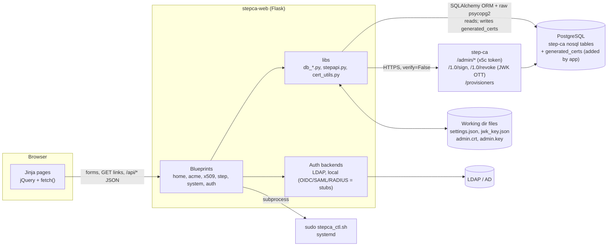

# stepca-web: Technical Analysis Report

| | |
|---|---|
| **Date** | 2026-10-13 |
| **Revision analysed** | `67caf4a` (`main`) |
| **step-ca reference** | `smallstep/certificates` at `v0.30.2-283-g69d3c36f` (local checkout `~/code/perso/certificates`) |
| **Method** | I read all first-party code (39 Python files, 20 Jinja templates) and checked it against the step-ca source. I also linted it with ruff (F/B/S/E9 rules), compiled it under Python 3.11 and scanned the git history. I did **not** run the app against a live CA, so the UX findings come from reading the templates, routes and JavaScript. |

> **Disclosure note:** this report describes exploitable weaknesses in code that is published on a public GitHub repository. Consider fixing the P0 items (§11) before you commit this file to the public repo.

---

## Executive summary

stepca-web is a Flask + AdminLTE admin console for a [step-ca](https://github.com/smallstep/certificates) instance that uses PostgreSQL and has remote management (`enableAdmin`) turned on.

- **Reads:** it reads step-ca's internal key/value tables directly from the database to list certificates, ACME objects, provisioners and admins.
- **Writes:** it acts through step-ca's Admin API, using an x5c admin token. It signs and revokes through `/1.0/sign` and `/1.0/revoke`, using a JWK one-time token.
- **Host control:** it can start and stop the CA's systemd service through `sudo`.

**Strengths.** The protocol work is good. The app builds step-ca-compatible x5c admin tokens. It decrypts PBES2-encrypted provisioner keys. It mints JWK one-time tokens (OTTs). It generates JWK provisioners that step-ca accepts. Doing all this in Python without an SDK requires a real understanding of step-ca internals.

**Weaknesses.** Everything around that core is still at prototype level. One core operation, revocation, silently does the wrong thing. Several advertised features are broken or missing. The security posture is far below what a component holding **CA super-admin credentials and a plaintext provisioner signing key** needs.

**Verdict:** a promising proof of concept that is **not safe to expose on any network** in its current state. The architecture is fine for an admin tool of this size. Most problems can be fixed incrementally, and a rewrite is not needed.

### Scorecard

| Area | Score (1–5) | One-line assessment |
|---|:-:|---|
| 1. Architecture | **2** | Reasonable Flask blueprint skeleton. However, there are two data-access stacks, side effects at import time, writes into the CA's database and an O(N²) read path. |
| 2. Code quality | **1.5** | No tests, CI, lockfile or logging. Star imports, dead code and many crash paths. |
| 3. Feature set | **2.5** | Good read coverage of X.509, ACME, provisioners and admins. Several advertised features are broken or absent. |
| 4. UX quality | **2** | Consistent AdminLTE look. Leftovers from the AdminLTE template, dead buttons, no search or paging, and raw IDs. |
| 5. step-ca integration | **2.5** | Strong understanding of the protocols. A critical revocation bug, no TLS verification and silent pagination truncation. |
| 6. Security | **1** | Secrets in public git history. 15 of 26 functional routes are unauthenticated, including CA admin actions. The debug server is the container entrypoint. |

### Top findings (fix first)

| ID | Severity | Finding |
|---|---|---|
| [SEC-1](#sec-1-critical-secrets-in-public-git-history) | Critical | The public GitHub history contains a **decrypted admin JWK private key**, two private keys and a `settings.json` with the DB password. |
| [SEC-2](#sec-2-critical-15-of-26-routes-have-no-authentication) | Critical | 15 of 26 functional routes are unauthenticated. Anyone who can reach the app can **create a SUPER_ADMIN, delete provisioners or admins, and stop the CA**. |
| [INT-1](#int-1-critical-revocation-revokes-a-serial-that-does-not-exist) | Critical | Revoking from the UI records a **non-existent serial** in step-ca, so the real certificate stays valid. The UI still shows it as revoked, which hides the problem. |
| [SEC-3](#sec-3-high-werkzeug-debug-server-is-the-production-entrypoint) | High | `app.run(debug=True, host="0.0.0.0")` is the Docker `CMD`. |
| [SEC-4](#sec-4-high-no-csrf-protection-destructive-get-endpoints) | High | There is no CSRF protection anywhere, and delete actions are plain GET links. |
| [INT-2](#int-2-high-revocation-status-is-computed-with-the-wrong-encoding) | High | Certificates revoked with `step ca revoke`, through ACME or over mTLS are shown as **Active**. |
| [INT-4](#int-4-high-tls-verification-disabled-root-fingerprint-unused) | High | TLS verification is off for all CA traffic (`verify=False`), and the configured root fingerprint is never used. |
| [PERF-1](#8-performance--scalability) | High | Listing certificates is O(N²) in database rows, and the dashboard does it three times per view. |
| [INT-3](#int-3-medium-admin-api-pagination-ignored-silent-truncation-at-20) | Medium | Admin API pagination is ignored. Only the first 20 provisioners and 20 admins are ever shown or usable. |
| [BUG-13](#23-correctness-bugs) | Medium | ACME provisioner creation is blocked by a hidden `required` field. Admin "Edit" creates duplicates. Several buttons do nothing. |

---

## 1. Architecture

### 1.1 Context and prerequisites

To work, the app needs:

- step-ca with **PostgreSQL** as its database and **remote management** enabled (`authority.enableAdmin: true`, i.e. `step ca init --remote-management`).
- `jwk_key.json` in the working directory: the **decrypted** private JWK of the "Admin JWK" provisioner. Per the README, this is produced with `step crypto jwe decrypt`.
- `settings.json` in the working directory: DB credentials, CA URL and root fingerprint.
- For service control: a sudoers rule plus `/usr/local/bin/stepca_ctl.sh`. Neither is in the repo or documented.
- An LDAP/AD server (the default auth backend), or local users hard-coded in source.

### 1.2 Component view



### 1.3 Code organisation

| Layer | Location | Responsibility | Notes |
|---|---|---|---|
| Entry and config | `run.py`, `config.py` | Start the dev server; load `settings.json`, with env override | Config is read **at import time** (`config.py:9`) |
| App factory | `app/__init__.py` | Register 8 blueprints; create the `generated_certs` table | Runs DDL against the CA database at startup (`app/__init__.py:23-26`) |
| Routes | `app/blueprint/{home,acme,x509,step,system,auth}` | HTML views plus two small JSON APIs (`/api/acme/*`, `/api/x509/*`) | Business logic lives in the route functions |
| Data access | `app/libs/db_*.py`, `app/models/*.py` | Decode step-ca's key/value tables | **Two mechanisms:** SQLAlchemy ORM (X.509, ACME) and raw psycopg2 with a connection per call (provisioners, admins) |
| CA client | `app/libs/stepapi.py` (535 lines) | Admin API, sign, revoke, JWK generation | One large class plus a `CAToken` helper |
| Crypto helpers | `app/libs/cert_utils.py` | Parse certificates and CSRs | Two near-duplicate parsers |
| Auth | `app/auth/`, `app/libs/auth/` | Backend factory and `login_required` | Only LDAP and local are implemented |
| UI | `app/templates/`, `app/static/` | AdminLTE 3 / Bootstrap 4 / jQuery | 1,891 vendored static files (65 MB), about 6 of them used |

### 1.4 Main flows

1. **Read path** (for example, *Active certificates*): `db_x509.get_x509_active_certs()` loads every row of `x509_certs`. For each row it then loads **every** row of `x509_certs_data` to find the matching provisioner (`db_x509.py:19,43-52`). It then loads every revoked row, parses each DER certificate with `cryptography`, filters by date and renders all of them, with no pagination.
2. **Admin write path** (for example, *create admin*): `StepCAClient._request()` calls `_get_jwt_token()`. If `admin.crt` is missing or has less than 1 hour left, the client generates a P-256 key and CSR. It then signs an OTT with the plaintext `jwk_key.json`, calls `/sign` and **writes `admin.crt` and `admin.key` to the working directory** (`stepapi.py:143-201`). Finally it builds an x5c JWT (`iss=step-admin-client/1.0`, `aud=<request URL>`) and calls `/admin/...`.
3. **Sign and revoke path:** the user types a provisioner passphrase. The app fetches `/provisioners`, decrypts the provisioner's `encryptedKey` (PBES2 JWE) in memory, mints a JWK OTT and posts it to `/1.0/sign` or `/1.0/revoke`. Signed certificates and their CSRs are also stored in `generated_certs`.
4. **Service control:** `POST /step/service/<action>` runs `sudo /usr/local/bin/stepca_ctl.sh <action>` (`step/routes.py:120`).

### 1.5 Trust boundaries and secrets held

| Secret | Where it lives | What it grants |
|---|---|---|
| DB credentials | `settings.json` (plaintext) or env vars | Read **and write** access to step-ca's DB. The app needs CREATE privilege for `generated_certs`. Write access means one can forge revocations, edit provisioners and so on. |
| Admin JWK private key | `jwk_key.json` (plaintext) | Signs **any certificate** that the "Admin JWK" provisioner allows, and mints super-admin x5c certificates. |
| Admin x5c cert and key | `admin.crt`, `admin.key` (working dir, default umask) | SUPER_ADMIN on the Admin API as subject `step`, for 24 h at a time. |
| Provisioner passphrases | Typed per operation | Decrypt provisioner keys inside the web process. One of them is printed to stdout (SEC-7). |
| Flask `SECRET_KEY` | Env var, otherwise random per process | Forging sessions. |
| sudo rule | `/etc/sudoers` (not in repo) | Start and stop the CA. |

**Key insight:** stepca-web is a **tier-0 component**. It holds a super-admin identity, a plaintext signing key, write access to the CA's database and control over the CA process. Compromising the web app is equivalent to compromising the CA's issuance policy, so it needs at least the same protection as the CA itself.

### 1.6 Assessment

**Strengths**
- The app factory plus one blueprint per domain is a clean and familiar Flask layout. A newcomer can find things quickly.
- The data-access, CA-client and route layers are roughly separated.
- The auth backend factory (`app/auth/factory.py`) is a sensible extension point.
- Server-rendered Jinja suits a low-traffic admin tool. The codebase is small enough to reason about as a whole.

**Weaknesses**

| ID | Issue | Consequence |
|---|---|---|
| A-1 | **Side effects at import time:** `config.py` opens `settings.json` and prints; three blueprint modules each create a `StepCAClient` at import (`step/routes.py:9`, `x509/routes.py:12`, `system/routes.py:8`, where it is unused), and each reads `jwk_key.json`. `create_app` runs DDL. | The app can't be imported without real files and a database, so it can't be unit-tested. Config edits need a restart (BUG-16). |
| A-2 | **Two DB stacks and two configs:** SQLAlchemy uses `SQLALCHEMY_DATABASE_URI`, while psycopg2 uses `DB_*`. psycopg2 opens a new connection per call, without pooling, and doesn't close it on exceptions. | The two stacks can point at different databases. Connections can leak. |
| A-3 | **Two sources of truth for provisioners:** the Admin API (provisioner page) and direct DB reads (`get_step_provisioners`, used for maps, dropdowns and the dashboard). | The two can disagree, for example on pagination or deleted items. |
| A-4 | **The app writes its own table into step-ca's database** (`generated_certs`). | The app needs CREATE on the CA's database and can't run with a read-only role. The table is also redundant, because `x509_certs` already stores the DER of every certificate. |
| A-5 | **No service layer.** Domain rules (what counts as "active") and presentation (`not_before_pretty`) are mixed into data functions. | Hard to test, and hard to reuse in an API. |
| A-6 | **Coupled to step-ca's internal storage format** (nosql key/value tables and Go JSON field names). | This is unavoidable for listing certificates, since open-source step-ca has no list-certificates API. It should be isolated in one adapter with fixture-based tests. Today the knowledge is spread out, and part of it is wrong (INT-1, INT-2). |
| A-7 | **Synchronous full-table reads on every page view**, with no caching. Certificates are immutable, so they are ideal to cache. | See §8. |
| A-8 | **One shared CA identity** (`step`) for every web user. | No attribution in step-ca's logs and no least privilege (INT-5). |
| A-9 | **State in the working directory** (`settings.json`, `jwk_key.json`, `admin.crt`/`admin.key`, all relative paths). | Behaviour depends on where the process starts. Multiple workers race on the admin certificate (BUG-17). |

### 1.7 Recommended target architecture (incremental)

- **Config:** load settings once in `create_app` from env or a file, for example with `pydantic-settings`. No I/O at import time. Make config read-only in the UI, or reload it explicitly.
- **CA client:** a single `StepCAClient` built in `create_app` and stored in `app.extensions`. It should use a `requests.Session` with the **pinned root** (bootstrapped from the fingerprint, see INT-4), timeouts and retries. Load secrets from a secret store, or keep the key encrypted at rest.
- **Data access:** one read-only SQLAlchemy engine for step-ca's tables, behind a `StepDBRepository`. The repository should own the step-ca encoding rules (serial key = decimal ASCII) and return typed dataclasses.
- **App state:** the app's own data (audit log, users and roles, metadata about issued certificates, cached inventory) belongs in a **separate** database or schema, managed with migrations (Flask-Migrate/Alembic).
- **Service control:** keep a tightly scoped sudoers rule, or remove the feature and leave CA lifecycle to systemd or Kubernetes. It doesn't work inside the provided container anyway.
- **UI:** keep server-side rendering. Add DataTables, which is already vendored, or HTMX for interactivity. At this size a SPA rewrite would mostly add cost.

---

## 2. Code quality

### 2.1 Metrics

| Metric | Value |
|---|---|
| First-party Python | 39 files, 2,106 lines (about 1,440 SLOC). 243 comment lines, mostly **commented-out code**. |
| Templates | 20 files, 2,412 lines |
| Vendored front-end | 1,891 files, 65 MB, 60 AdminLTE plugin packages, about 6 of them used |
| Automated tests | **0** |
| CI, linter, type-checker, pre-commit config | **None** |
| Dependency manifest | `requirements.txt` with 16 **unpinned** entries and no lockfile. 5 are unused (`flask-login`, `flask_wtf`, `authlib`, `psutil`, `protobuf`). `gunicorn` is installed but never used. |
| Logging | 73 `print()` calls (many with emojis) and no `logging` |
| ruff (`F,B,S,E9`) | 36× F405 + 13× F403 (star imports), 8× F401 unused imports, 7× F811 redefinitions, 4× S113 requests without timeout, 4× F541, 3× F841, plus S104, S110, S311, S501, S603, S607 |
| Python version | **Requires 3.12+.** `step/routes.py:62,64` reuses the same quote character inside f-strings (PEP 701), which fails on 3.11 with `SyntaxError: f-string: unmatched '['`. I verified this. The README says "Python 3.9+". |

### 2.2 Strengths

- Database access uses the ORM or parameterised SQL (`db_jwk.py`), so I found no SQL injection.
- `subprocess` gets a fixed argv list and the action is checked against an allow-list (`step/routes.py:116-120`), so there is no shell injection.
- Jinja autoescaping protects all server-rendered output.
- Local passwords use Werkzeug's scrypt hashing.
- The cryptographic code uses well-established libraries (`cryptography`, `jwcrypto`) and does not hand-roll primitives.

### 2.3 Correctness bugs

| ID | Location | Defect | Effect |
|---|---|---|---|
| BUG-1 | `app/blueprint/step/routes.py:18-61` | `resp` is only assigned inside two independent `if` branches | Any other `type` value raises `UnboundLocalError` (HTTP 500) |
| BUG-2 | `step/routes.py:66-67`, `stepapi.py:285-287` | `list_provisioners()` returns `None` on error, and the route then indexes it | Any CA or API error gives HTTP 500 instead of an error message |
| BUG-3 | `stepapi.py:176-183` | `data` is undefined when `/sign` does not return 201 | Failure to bootstrap the admin certificate raises `UnboundLocalError`, which hides the real CA error |
| BUG-4 | `stepapi.py:389-390` | `list_admins()` ignores the HTTP status | An error body crashes the template with a `KeyError` |
| BUG-5 | `stepapi.py:429-440` | `public_get_provisioner_by_name` returns `None` when the provisioner isn't found, and only searches the first page (INT-3) | Sign or revoke shows `'NoneType' object is not subscriptable` to the user |
| BUG-6 | `stepapi.py:496-498` | `health()` uses `self.url` and `self.cert_bundle_fn`, which don't exist | Broken (also dead code) |
| BUG-7 | `stepapi.py:55-69` | `CAToken.decrypt_and_merge` calls `jose.jwk.JWK.from_password`, which doesn't exist | Broken duplicate of `stepapi.py:521` |
| BUG-8 | `x509/routes.py:43-45` | `url_for("x509/x509.active_certs")` is not a valid endpoint, and the flash message prints `None` | Downloading an unknown serial raises `BuildError` (HTTP 500) |
| BUG-9 | `db_x509.py:19-22` | A certificate with no `x509_certs_data` row raises `TypeError` | A valid certificate is shown as `[error decoding cert]` |
| BUG-10 | `db_x509.py:125` | A revoked row that failed to parse has no `"Serial"` key | One bad row breaks both the *Active* page and the dashboard |
| BUG-11 | `templates/step/admin.html:170` + `step/routes.py:81-94` | The *Edit admin* form posts to the **create** handler, and `admin_id` is ignored | "Edit" creates a **duplicate** admin |
| BUG-12 | `templates/step/provisioners.html:262-267` | The *Save* handler only calls `console.log` | Editing a provisioner does nothing |
| BUG-13 | `templates/step/provisioners.html:210-214` | The passphrase field is `required` inside a `display:none` block, and ACME is the default type | The browser refuses to submit, so **ACME provisioners cannot be created** |
| BUG-14 | `templates/x509/all_certs.html:75,79` | `loadX509Cert` isn't defined on this page, and *revoke* links to `GET /x509/revoke/<id>`, which doesn't exist | The view and revoke buttons on *All* are dead (JS error, then 404) |
| BUG-15 | `templates/acme/orders.html:84` | `loadCert()` and `#certModal` don't exist | The order "View" certificate link is dead |
| BUG-16 | `system/routes.py:26-42` | Writes `settings.json`, but config is only read once at import | The UI says "updated successfully" but nothing changes until restart |
| BUG-17 | `stepapi.py:186-199`, `stepapi.py:203-206` | Any worker rewrites `admin.crt` and `admin.key` non-atomically when the certificate is close to expiry | With several gunicorn workers, a request can load a mismatched cert and key |
| BUG-18 | `config.py:51-53` | `SECRET_KEY` is random per process when unset | Sessions are lost on every restart, and with N workers users get logged out at random |
| BUG-19 | `templates/home/index.html:218` | `cert.provisioner.name` throws for entries without a `provisioner` key (the BUG-9 error rows) | The whole "issuance" bar chart fails to render |
| BUG-20 | `blueprint/acme/api.py`, `blueprint/x509/api.py` | Empty lists return **404** | The dashboard charts break on a fresh CA. The REST semantics are also wrong. |

### 2.4 Maintainability issues

- **Star imports everywhere** (`from app.libs.db_acme import *` and others). `system/routes.py` only works because `os` and `json` leak in through `from app.libs.stepapi import *`.
- **Duplication:**
  - `parse_cert` and `parse_cert_from_bytes` are about 80% identical.
  - `decrypt_and_merge` exists twice.
  - The flash-message block is copied into 5 templates.
  - Every template re-declares the font, Font Awesome and AdminLTE CSS links that `base.html` already loads, so `adminlte.min.css` loads twice per page.
- **Dead code:**
  - `models/post.py` and `models/question.py` (leftovers from a Flask tutorial).
  - `db_jwk.py` and `db_init.py` (the `jwk_keys` table is no longer used).
  - Unused functions: `decode_certificate`, `get_subject_string`, `update_provisioner`, `get_step_admins`, `get_acme_cert_by_id`, `get_x509_certs_data`, `_compare_fingerprints`, `_save_tempfile`.
  - `_page_template.html`.
  - About 170 lines of commented-out code in `db_acme.py` and `system/routes.py`.
- **Error handling:** broad `except Exception: print(...)` that swallows errors, and raw exception text shown to users (`Failed to sign certificate with error …`).
- **Three JOSE libraries** (python-jose, PyJWT, jwcrypto) for one job. python-jose has had little maintenance and a history of CVEs. Standardise on `jwcrypto`, which is already required for the JWE work.
- **Four `requests` calls without a timeout**, so a hung CA ties up worker threads indefinitely.
- **Deprecated date handling:** `datetime.utcnow()` and `utcfromtimestamp()` are deprecated in 3.12, and `pytz` is unnecessary.
- **Weak typing:** almost no type hints, and nested dicts are passed to templates (`cert["data"]["provisioner"]["name"]`).
- **Typos that reach the UI:** "Provisionner" (×3), "Name111", "ACMECertificates".

### 2.5 Recommendations

1. Move to `pyproject.toml` + `uv.lock` and pin everything. Remove the unused dependencies and python-jose.
2. Add `ruff` (lint and format) and `pyright` or `mypy`, enforced with pre-commit and GitHub Actions.
3. Replace `print` with `logging`, and add a rule that secrets and tokens are never logged.
4. Remove the dead code, the commented-out blocks and about 98% of the vendored assets.
5. Add tests (see §9).

---

## 3. Feature set

### 3.1 What the README claims vs. what the code does

| Advertised feature | Status | Notes |
|---|---|---|
| ACME: "list **and manage**" accounts, orders, certs, authorizations, challenges | ⚠️ Read-only, partial | Flat lists only. No deactivation and no links between related objects. The order → certificate link is broken (BUG-15). The pages are unauthenticated (SEC-2). |
| X.509: valid and revoked certificates with details and provisioners | ⚠️ Partial | The lists work. Revoked status is wrong for revocations made outside the UI (INT-2). The details modal only works on *Active*. |
| SSH certificate management | ❌ Missing | No code reads `ssh_certs` or `revoked_ssh_certs`. |
| Provisioners: list, add, delete (JWK/ACME) | ⚠️ Partial | The list is capped at 20 (INT-3). Adding a JWK provisioner works. Adding an ACME provisioner is blocked (BUG-13). Edit does nothing (BUG-12). Delete works, but as an unauthenticated GET. |
| Admin users: view and manage | ⚠️ Partial | List (capped at 20), create and delete work. Edit creates a duplicate (BUG-11). |
| "Step CA Config Editor: edit and validate `ca.json` with JSON syntax highlighting" | ❌ Not implemented | `/system/config` edits the **app's own** `settings.json` (DB credentials and CA URL). There is no `ca.json` editing and no syntax highlighting. |
| Systemd service control | ⚠️ Works, with external prerequisites | Needs an undocumented sudoers rule and `stepca_ctl.sh`. Unauthenticated. Can't work in the Docker image. |
| Dashboard KPIs | ✅ Works | Expensive (§8). The "Certificate Issuance" chart is actually *certificates per provisioner*, over all time. |
| Sign a CSR | ⚠️ Works for JWK only | ACME provisioners are offered but can't work. Template data is hard-coded (INT-7). Validity can't be chosen. |
| Revoke | ❌ **Broken** | Revokes the wrong serial (INT-1). The reason is always keyCompromise (INT-8). |
| Download a certificate | ⚠️ Partial | Only for certificates signed through this UI (from `generated_certs`). |
| Auth backends: LDAP, RADIUS, SAML, OIDC, local | ⚠️ Partial | Only LDAP and local are implemented. The other three are stubs that always fail. The README to-do still says "Add user authentication". |

### 3.2 Coverage of step-ca's capabilities

| step-ca capability | Interface | stepca-web |
|---|---|---|
| X.509 inventory | DB only (no API) | ✅ List and detail |
| Sign with a JWK OTT | `POST /1.0/sign` | ✅ |
| Revoke | `POST /1.0/revoke` | ❌ Broken (INT-1) |
| CRL | `GET /crl` | ❌ |
| Health, version, roots, federation | `GET /health`, `/version`, `/roots`, `/federation` | ❌ (only `systemctl status`) |
| SSH certificates (inventory, revoke, hosts) | DB + `/1.0/ssh/*` | ❌ |
| Provisioners CRUD | `/admin/provisioners` | ⚠️ Create (JWK/ACME), read (≤ 20), delete. Update is missing (`update_provisioner()` exists but is never called). |
| Other provisioner types: OIDC, X5C, K8sSA, SSHPOP, SCEP, Nebula, AWS/GCP/Azure | `/admin/provisioners` | ❌ |
| Claims (renewal, SSH durations, `disableRenewal`, …), x509/ssh templates, options | `/admin/provisioners` | ❌ (only x509 default/min/max durations) |
| Admins CRUD | `/admin/admins` | ⚠️ Create, read (≤ 20), delete. `PATCH` is missing. |
| ACME External Account Binding keys | `/admin/acme/eab/*` | ❌ So "Require EAB" provisioners can't be used from the UI. |
| Policies (authority, provisioner, ACME account) | `/admin/policy`, `/admin/provisioners/{p}/policy`, `/admin/acme/policy/*` | ❌ |
| Webhooks | `/admin/provisioners/{p}/webhooks` | ❌ |
| ACME objects | DB | ✅ Read-only |

### 3.3 Missing features, ranked by operator value

1. **Expiry monitoring.** An "expiring in 7/30 days" view, a dashboard tile and optional e-mail or webhook alerts. This is the single most useful view for a CA operator.
2. **Search, filter, sort and paginate** every table.
3. **A certificate detail page** (`/x509/<serial>`) with PEM, chain and DER downloads for **any** certificate, sourced from `x509_certs`, which removes the need for `generated_certs`.
4. **Correct revocation** with a choice of reason, available from every list including ACME.
5. **RBAC** (viewer / operator / admin) and an **audit log** of who did what.
6. **EAB key management**, needed as soon as a provisioner has "Require EAB" ticked.
7. **Provisioner editing** (claims, templates, ACME challenges) through `PUT`, and **admin type change** through `PATCH`.
8. A **CA status page**: health, version, roots and fingerprints, CRL download.
9. **SSH inventory**, then policies and webhooks.
10. CSV export.

---

## 4. UX quality

### 4.1 Overall impression

AdminLTE gives the app a consistent, recognisable look. The sidebar grouping (ACME / X.509 / step-ca Management / System) is logical. However, the UI still reads like a **template demo with data plugged in**: there are leftovers from the AdminLTE theme, controls that do nothing, and tables that dump raw data. It isn't organised around what an operator needs to do, such as "find the certificate for host X and revoke it" or "what expires this week?".

### 4.2 Template leftovers and dead controls

- `layouts/base.html:8` declares `<link rel="canonical" href="https://appseed.us/adminlte">`.
- The top nav has *Home* pointing to `index3.html` (404), *Contact* pointing to `#`, and a search box that does nothing (`includes/navigation.html:9,12,17-26`).
- The sidebar search box (`includes/sidebar.html:19-28`) and the hamburger menu need `adminlte.js`, which is **only loaded on the dashboard**.
- The dashboard loads AdminLTE's **`demo.js`** (`home/index.html:203`), its theme-customizer demo script.
- The dashboard tiles use `ion ion-*` icon classes, but the Ionicons CSS is never loaded, so the tile icons are blank.
- Active-menu highlighting depends on a `segment` variable that is never set (`sidebar.html:34`), so the current page is never highlighted. *Revoked* and *All* use a `user-plus` icon.
- `auth/login.html` doesn't extend any layout (no `<html>` or `<head>`). It also contains GitHub and Google sign-in buttons that point to a blueprint that doesn't exist (`login.html:67-81`).

### 4.3 Data presentation

- **The first column, "Id", on the X.509 pages is the hex encoding of the ASCII decimal serial.** For a 128-bit serial that is 78 meaningless characters, and it is the widest, most prominent column.
- "Serial" is shown in hex without leading zeros or colons. The step CLI, step-ca logs and `step ca revoke` use **decimal** (or `0x`-prefixed hex), so operators can't cross-reference serials.
- Dates are inconsistent. The X.509 pages show "May 22, 2025", while the ACME and revoked pages show raw RFC 3339 with nanoseconds. No timezone is shown, there is no relative time ("in 3 days") and expiry has no colour coding.
- The ACME certificates SAN column renders a Python list repr (`['a.example.com']`) (`acme/certs.html:63`).
- The admin table shows the provisioner **UUID**, even though the view already has a UUID-to-name map.
- The revoked page doesn't show the reason or reason code. Its "Id" column holds the serial, and its "Serial" column is empty for revocations it can't match (INT-2).
- Wide tables (10 columns, full RFC 4514 subject **and issuer**, where the issuer is the same on every row) force horizontal scrolling.
- There are no empty-state messages and no pagination, so pages grow without limit.

### 4.4 Navigation and information architecture

- A certificate has **no page or URL of its own**. Details only exist in a modal on *Active*, so you can't link a colleague to a certificate.
- The ACME data is five flat menu items for what is really one drill-down (account → orders → authorizations → challenges → certificate). The IDs needed to link them are already present.
- No global search exists. Both search boxes are cosmetic.

### 4.5 Forms and workflows

- **Submit CSR:**
  - The dropdown lists ACME provisioners, which can't sign with a passphrase.
  - The CSR can only be pasted (no file upload).
  - There is no way to override validity or SANs, and no preview of the parsed CSR.
  - After a successful signing, the user has to find the certificate in the list to download it.
  - Only the leaf PEM is offered, with no chain or full chain.
- **Revoke:**
  - The modal doesn't say *which* certificate is being revoked.
  - It asks for a "Provisioner Passphrase" without naming the provisioner (it is the admin provisioner).
  - There is no reason field.
  - It reports success even though the wrong serial was revoked (INT-1).
  - It is unavailable on the *All* and ACME pages.
- **Create provisioner:**
  - Blocked for ACME, the default type (BUG-13).
  - Durations are free text with no Go-duration validation.
  - ACME challenge types are hard-coded integers.
- **Edit provisioner:** dumps the raw JSON, including the encrypted key, as a recursive form, and *Save* does nothing.
- **Admins:** *Edit* creates a duplicate. The delete confirmation says "delete this **provisioner**".
- **Destructive actions:**
  - Deleting a provisioner or an admin is a plain GET link guarded only by `confirm()`.
  - **Stop CA** has no confirmation at all.
- **Config page:**
  - Says "updated successfully" although nothing applies until restart.
  - Pre-fills the password field with the real DB password, which is visible in the page source.

### 4.6 Feedback and errors

- Only 5 templates render flash messages. On every other page, flashed messages are lost.
- Errors appear as raw Python or jwcrypto exception text. For example, a wrong passphrase surfaces a JWE decryption exception.
- Slow pages have no loading indicator, and all pages load synchronously in full.
- `step/service.html` uses `fetch` without a `.catch`. If the session has expired, the response is the login HTML, JSON parsing fails, and the user sees nothing.

### 4.7 Accessibility and front-end hygiene

- Icon-only buttons (view, revoke, download, edit, delete) have no `title` or `aria-label`.
- Library loading is inconsistent:
  - The dashboard uses a **local** jQuery.
  - The other pages load jQuery 3.6.0 and Bootstrap 4.6.2 from **CDNs without Subresource Integrity**.
  - Google Fonts is loaded on every page.
- **PKI environments are often air-gapped.** In such an environment the CDN-loaded scripts and fonts will fail, and modals and forms on most pages will stop working.
- Bootstrap 4 reached end of life in January 2023, and AdminLTE 3 is built on it.

### 4.8 UX recommendations

**Quick wins (about a day)**

- Remove the template leftovers.
- Use one base layout that loads jQuery, Bootstrap and AdminLTE **locally**, once.
- Enable DataTables (already vendored) on every table for search, sort and paging.
- Replace the "Id" column with *Serial (dec)* and a copyable *Serial (hex)*.
- Use one date format, plus a "days left" badge (red under 7 days, amber under 30).
- Move the flash partial into `base.html`.
- Add `aria-label`s.
- Fix BUG-11 to BUG-15.

**Medium**

- A certificate detail page with PEM, chain and download links, extensions, provisioner, revocation status and actions.
- An expiring-soon dashboard.
- An ACME drill-down.
- A revoke modal that shows the subject and serial and offers a reason.
- Modal confirmations for destructive actions, sent as POST.
- Forms specific to each provisioner type.

**Larger**

- A UI that adapts to the user's role.
- An audit-trail view.

---

## 5. Integration with step-ca

### 5.1 Integration surfaces

| Surface | Mechanism | Used for |
|---|---|---|
| PostgreSQL, step-ca tables | SQLAlchemy models over `x509_certs`, `x509_certs_data`, `revoked_x509_certs`, `acme_*`; psycopg2 over `provisioners`, `admins` | Inventory and dashboards |
| PostgreSQL, app table | `generated_certs` (created by the app) | Download of UI-signed certificates |
| Admin API | x5c JWT from a self-issued 24 h admin certificate | Provisioners and admins CRUD |
| Public API | JWK OTT from a passphrase-decrypted provisioner key | `/1.0/sign`, `/1.0/revoke`, `/provisioners` |
| Host | `sudo stepca_ctl.sh` | start / stop / restart / status |

### 5.2 What the integration gets right

- **The x5c admin token matches what step-ca checks**: ES256, `x5c` chain, `iss = "step-admin-client/1.0"`, `aud` = request URL and a non-empty `sub` (`certificates/authority/authorize.go:147-165`).
- **JWK provisioner creation is compatible with step-ca.** It uses a P-256 key, `kid` = RFC 7638 thumbprint, and a PBES2-HS256+A128KW JWE for the encrypted key. The payload is sent in the linkedca `details.JWK` shape.
- **Provisioner rows are decoded correctly.** `details` is base64-encoded JSON in `dbProvisioner` (`certificates/authority/admin/db/nosql/provisioner.go:16-28`). The soft-delete marker `deletedAt == 0001-01-01T00:00:00Z` (Go's zero time) is handled correctly.
- **ACME `leaf`** (PEM bytes, base64 inside JSON) is decoded correctly.
- **`passive: true` is used**, which is the only revocation mode step-ca implements (`certificates/api/revoke.go:45-47`).
- **The defaults match what step-ca creates** on first start with remote management: provisioner "Admin JWK" and super admin `step` (`certificates/authority/provisioners.go:378`, `certificates/authority/authority.go:708-714`).

### INT-1 (Critical): revocation revokes a serial that does not exist

**How step-ca stores certificates.** The key of a certificate in `x509_certs` is the **decimal serial as ASCII bytes** (`certificates/db/db.go:324`):

```go
db.Set(certsTable, []byte(crt.SerialNumber.String()), crt.Raw)
```

**How stepca-web builds the identifier.** It uses the hex of those ASCII bytes as the certificate "ID" (`app/libs/db_x509.py:16`), then sends that ID as the serial to `/1.0/revoke` (`app/blueprint/x509/routes.py:104` → `app/libs/stepapi.py:442-452`).

**How step-ca parses it.** step-ca parses the serial with `big.Int.SetString(s, 0)` (`certificates/api/revoke.go:37`). With base 0, a string without a `0x` prefix is read as **decimal**. Hex-of-ASCII consists of digits only (`3x` pairs), so it is accepted as a valid but **different** number. The OTT subject is set to the same string, so the subject check passes (`certificates/authority/tls.go:626`), and step-ca happily stores a revocation for a serial that was never issued.

I reproduced the transformation with a typical 128-bit serial:

```
real serial (dec):       119960802063269571811733802872440608485
cert_id sent to /revoke: 313139393630383032303633323639353731383131373333383032383732343430363038343835
serial step-ca revokes:  313139393630383032303633323639353731383131373333383032383732343430363038343835
same certificate?        False
```

**Impact**
- The real certificate is **not revoked**. `IsRevoked(<real serial>)` returns false (`certificates/db/db.go:181`), so **renewal keeps working**. The CRL contains a bogus serial instead of the real one (`certificates/authority/tls.go:819`).
- **The UI hides the failure.** Its own "is revoked" check uses the same wrong encoding (INT-2), so the certificate disappears from *Active* and shows up under *Revoked*. The operator believes it worked.
- Every revocation made through the UI so far needs to be re-done.

**Fix**

```python
# db_x509.py: step-ca's key *is* the decimal serial string
serial_dec = row.nkey.decode("ascii")
...
client.revoke(serial_dec, passphrase)          # or f"0x{serial_int:x}"
```

**Clean-up of past UI revocations** (run in `flask shell`, read-only):

```python
import json, re
from app.models.x509 import X509Cert, RevokedX509Cert
issued = {bytes(r.nkey) for r in X509Cert.query.with_entities(X509Cert.nkey)}
for r in RevokedX509Cert.query.all():
    s = json.loads(r.nvalue)["Serial"]
    if re.fullmatch(r"(3[0-9])+", s) and bytes.fromhex(s) in issued:
        print("re-revoke:", bytes.fromhex(s).decode())   # then: step ca revoke <serial>
```

### INT-2 (High): revocation status is computed with the wrong encoding

`get_x509_active_certs()` compares `revoked.Serial` (decimal, as stored by step-ca) with `cert.nkey` (hex of ASCII) (`db_x509.py:125-133`). `get_revoked_x509_with_cert_info()` makes the same mistake (`db_x509.py:77`). As a result:

- Certificates revoked with `step ca revoke`, through ACME `revokeCert` or over mTLS are **listed as Active** and counted as active on the dashboard.
- The *Revoked* page can't resolve their subject, issuer or serial.

**Fix:** normalise both sides to the decimal string (`nkey.decode()`). Display decimal and hex side by side.

### INT-3 (Medium): Admin API pagination ignored, silent truncation at 20

`/admin/provisioners`, `/admin/admins` and the public `/provisioners` return at most **20** items by default, plus a `nextCursor` (`certificates/authority/provisioner/collection.go:22`, `certificates/authority/administrator/collection.go:14`). The client never sends `limit` and never follows the cursor (`stepapi.py:285-287,389-390,429-440`). As a result:

- Provisioners and admins beyond the 20th are invisible.
- Signing or revoking with a provisioner that isn't on the first page fails with BUG-5.

**Fix:** loop with `?limit=100&cursor=…`. To fetch a single provisioner, use `GET /admin/provisioners/{name}` instead of scanning the public list.

### INT-4 (High): TLS verification disabled, root fingerprint unused

- Every call uses `verify=False`, and urllib3 warnings are silenced globally (`stepapi.py:36,174,254,260`).
- `CA_FINGERPRINT` is configured but only placed in the OTT `sha` claim. `_compare_fingerprints()` is never called.
- With verification off, a network attacker can capture admin tokens and OTTs and feed fake data to the UI.
- **Fix:** step's own trust-bootstrap model. Fetch `GET /root/{fingerprint}` (`certificates/api/api.go:331`), check the SHA-256 locally, save the root, and use it as `verify=` on a shared `requests.Session`.

### INT-5 (Medium): every web user acts as the same CA super admin

All Admin API calls are made as subject `step` (SUPER_ADMIN) (`stepapi.py:91-100`), so step-ca's logs can't tell which human made a change, and there is no least privilege. Options, from simplest to best:

1. Create a **dedicated** admin for the app, using type `ADMIN` instead of `SUPER_ADMIN` unless admin management is needed. Add a local audit log in the app.
2. Bind the app's JWK provisioner to a **provisioner X.509 policy** that only allows the admin subject. A leaked key could then not mint arbitrary TLS certificates.
3. **Per-user identity:** log users in with OIDC against the same IdP that step-ca's OIDC provisioner trusts, obtain a short-lived x5c admin certificate **per user**, and sign admin tokens with it. step-ca's logs then record the real operator.

### INT-6 (Medium): plaintext provisioner key on disk makes the revoke passphrase meaningless

`jwk_key.json` is the **decrypted** key of the admin provisioner. `revoke()` asks the user for that provisioner's passphrase to decrypt the very same key (`stepapi.py:443-448`). The prompt adds friction but no protection, because anyone who controls the server already has the key. Pick one of these:

- (a) Keep only the encrypted key, and decrypt it at startup with a passphrase from a secret store.
- (b) Stop asking for the passphrase.

Option (a) is recommended. In both cases, restrict file permissions to `0600`.

### INT-7 (Low): hard-coded template data copied from the docs example

Every sign request sends `templateData: {"subject": {"country": "US", "organization": "Coyote Corporation", …}}` (`stepapi.py:480-487`). step-ca only exposes this data as `.Insecure.User` (`certificates/authority/provisioner/options.go:166-171`), so it has no effect with the default templates. However, any custom template that uses `.Insecure.User` would stamp "Coyote Corporation / US" on production certificates. Remove it or make it configurable.

### INT-8 (Low): revocation reason fixed to keyCompromise

`reasonCode: 1` (keyCompromise) and `reason: "revoked"` are hard-coded (`stepapi.py:452`). This produces misleading CRL entries. Offer the RFC 5280 reasons, which step-ca accepts in the range 0–10.

### INT-9 (Medium): coupling to step-ca's database

- **Unavoidable coupling:** open-source step-ca has no inventory API, so reading the nosql tables is the only option. That makes the app depend on an **undocumented internal format** and on **PostgreSQL** only (step-ca also supports Badger, BoltDB and MySQL).
- **Mitigations:**
  - Use a **read-only DB role**.
  - Move `generated_certs` out of the CA's database.
  - Put all format knowledge in one adapter.
  - Check `GET /version` at startup against a tested range.
  - Add contract tests that run against a real step-ca (§9).

### INT-10 (Low): documentation mismatch

The README asks for the "Remote Provisioner". The actual feature is **remote management** (`authority.enableAdmin: true`, `step ca init --remote-management`).

---

## 6. Security

### SEC-1 (Critical): secrets in public git history

`github.com/damhau/stepca-web` is **public**. Its history still contains files that were later deleted:

| File | Added → removed | Content (by structure, values not printed) |
|---|---|---|
| `jwk_key.json` | `ca57e45` → `4793e84` | EC JWK **including the private `d` component**, i.e. a decrypted provisioner key |
| `admin.key`, `_old/_app.old/admin.key` | `ca57e45` → `f11c83b`, `534c698` | PKCS#8 private key (admin x5c certificate, now expired) |
| `svc.key` | `2fef648` → `90e2525` | EC private key (expired leaf issued by a **third-party organisation's** sub-CA) |
| `settings.json` | `876e193` → `1b1151e` | DB host, user and **non-empty password**, CA URL, fingerprint |
| `app/libs/auth/local_backend.py` | current | scrypt hash of the local `admin` password (can be attacked offline if the password is weak) |

**Impact:** if the "Admin JWK" provisioner in that history is still active, anyone can mint certificates from that CA and obtain super-admin access to its Admin API.

**Action, in this order:**

1. Compare `git show ca57e45:jwk_key.json | jq -r .kid` with `step ca provisioner list | jq -r '.[] | select(.name=="Admin JWK") | .key.kid'`. If they match, **create a new admin provisioner, move the super admin to it, and delete the old one**.
2. Rotate the DB password.
3. Change the local admin password, and move local users out of source code.
4. Rewrite history (`git filter-repo`) and force-push, but **treat the secrets as already compromised** regardless: forks and clones may exist.
5. Add `.gitignore` and `.dockerignore` entries and a secret scanner (gitleaks or trufflehog) to pre-commit and CI.

### SEC-2 (Critical): 15 of 26 routes have no authentication

`login_required` is applied route by route, and most routes don't have it (see the full table in Appendix A). **Without logging in**, anyone who can reach the app can:

- **Create a SUPER_ADMIN** on the CA (`GET/POST /step/admins`), using the app's own super-admin identity.
- **Delete any provisioner** (`GET /step/provisioner/<name>/delete`), which takes down issuance, and **delete any admin** (`GET /step/admin/<id>/delete`).
- **Stop or restart the CA** (`POST /step/service/stop`).
- Read the whole ACME inventory, including account contact e-mails and every requested hostname (`/acme/*`, `/api/acme/*`), and the revocation list (`/x509/revoked`).
- Submit revocations (`POST /x509/revoke`). This still needs the passphrase.

**Fix:** deny by default. Use an `app.before_request` hook that requires a session for everything except `/auth/login` and `/static/`, instead of per-route decorators.

### SEC-3 (High): Werkzeug debug server is the production entrypoint

`run.py:6` calls `app.run(debug=True, host="0.0.0.0")`, and the Dockerfile's `CMD` is `python run.py`. The interactive debugger and reloader are therefore exposed on every interface. Given the number of crash paths (§2.3), stack traces with source code and configuration will be shown to users. The debugger PIN is only weak protection.

**Fix:** run `gunicorn "app:create_app()"`, which is already a dependency, and never enable debug outside local development.

### SEC-4 (High): no CSRF protection, destructive GET endpoints

Flask-WTF is listed as a dependency, but `CSRFProtect` is never initialised. Every POST form, including create admin, create provisioner, sign, revoke and config, can be forged from another site. Deletes are **GET** links, so even an `` on a page an authenticated admin visits will trigger them.

**Fix:**
- Turn on `CSRFProtect`.
- Make every state change a POST, PUT or DELETE.
- Set `SESSION_COOKIE_SAMESITE="Lax"` or `"Strict"`.

### SEC-5 (High): no authorization model

Every authenticated user is effectively a **CA super admin with host service control**. There are no roles. The LDAP group check is the only gate, and it is all-or-nothing. It is also misconfigured by default: `LDAP_REQUIRED_GROUP_DN` falls back to the base DN (`config.py:49`), which no user is a member of.

**Fix:** add roles (viewer / operator / admin), mapped from LDAP or OIDC groups, and keep an audit log of every write.

### SEC-6 (High): cleartext and unverified transport

- CA traffic is unverified (INT-4).
- LDAP defaults to `ldap://` with a simple bind, so **user passwords cross the network in cleartext** (`config.py:44`, `ldap_backend.py:20-22`).

**Fix:** require LDAPS or StartTLS, with certificate validation.

### SEC-7 (Medium): secrets in logs

- `stepapi.py:321` prints the **new JWK provisioner's passphrase** to stdout.
- `stepapi.py:453` and `stepapi.py:488` print full payloads, including one-time tokens. The tokens are short-lived but still sensitive.
- `config.py:38` prints DB connection details at import.

**Fix:** remove these prints and adopt structured logging with redaction.

### SEC-8 (Medium): secrets at rest

- `jwk_key.json`, `admin.key` and `settings.json` are plaintext files in the working directory.
- `admin.key` is written with the default umask, usually `0644`, which makes it world-readable (`stepapi.py:192`).
- The DB password is rendered into the HTML of `/system/config` (`config_edit.html:75`).
- No `.dockerignore` exists, so `COPY . .` bakes any local secrets into the image.

### SEC-9 (Medium): session and login hardening

- `SECRET_KEY` falls back to Python's non-cryptographic `random` module (`config.py:51-53`).
- The session ID isn't rotated at login, and logout doesn't clear the session.
- There is no session lifetime and no rate limiting or lockout on `/auth/login`.
- There is no `SESSION_COOKIE_SECURE` and no security headers (CSP, HSTS, frame-ancestors).

**Fix:**
- Use `secrets.token_hex()`, and require it to be set in production.
- Call `session.clear()` on login and logout.
- Set `PERMANENT_SESSION_LIFETIME`.
- Use Flask-Limiter for rate limiting and Flask-Talisman for security headers.

### SEC-10 (Medium): DOM-XSS sinks

Two places build HTML from data:

- `provisioners.html:276-327` (`generateForm`) interpolates provisioner keys and values into HTML. Values that contain quotes, such as JSON templates, break the form today.
- `active_certs.html:238-251` writes certificate fields with `innerHTML`.

With step-ca's default templates, attackers can't control these fields: ACME only copies the CSR common name (`certificates/acme/order.go:236`). They become exploitable with custom templates that copy CSR subject fields. In that case a malicious CSR could run script in an admin's browser and drive the (unprotected) admin endpoints.

**Fix:** use `textContent` or build DOM nodes.

### SEC-11 (Low): LDAP filter injection

`ldap_backend.py:27` inserts the username into the search filter without escaping. Exploitation is limited because the bind happens first, but the fix is a one-liner: `ldap3.utils.conv.escape_filter_chars`.

### SEC-12 (Low): supply chain and container

- Dependencies are unpinned and there is no lockfile.
- Front-end scripts are loaded from CDNs without SRI.
- The image runs as root and carries `gcc`, `build-essential` and `libpq-dev`. Use `psycopg[binary]` or a multi-stage build.
- There is no `HEALTHCHECK`.
- 60 vendored JS packages bring their own known-vulnerability history without adding anything.
- `jwa.default_max_pbkdf2_iterations` is raised globally to 10,000,000 (`stepapi.py:30`). With TLS verification off, a man-in-the-middle can serve a JWE with a huge iteration count and burn CPU. Cap the limit at what step actually uses.

### Threat summary

| Attacker | Today | After the P0 and P1 fixes |
|---|---|---|
| Anyone on the network | CA admin takeover, provisioner deletion, CA shutdown, inventory disclosure | Login page only |
| Malicious site visited by an admin | Any action through CSRF or a GET link | Blocked (CSRF tokens, SameSite, POST-only) |
| Anyone with GitHub access | Possibly a working CA signing key and DB credentials | Nothing, once rotated |
| Network position between app and CA | Token capture and data spoofing | Blocked by the pinned root |
| Authenticated low-privilege user | Full super admin | Bound to a role and audited |

---

## 7. Operations and deployment

- **Configuration:**
  - `settings.json` is **mandatory at import** (`config.py:9`), even when every value is provided by env vars, so 12-factor deployment is impossible.
  - The path is relative to the working directory, while the README says `app/settings.json`.
  - The env var mapping (`database.host` → `DATABASE_HOST`, …) is undocumented.
  - Config changes made through the UI need a restart (BUG-16).
- **Docker:**
  - The image uses the dev server with debug on (SEC-3), runs as root and keeps the build toolchain.
  - It has no `.dockerignore` and no health check.
  - `jwk_key.json` and the admin certificate need volumes that aren't documented.
  - Service control (`sudo` + systemd) **can't work inside a container**.
  - Python 3.12 in the image is correct and in fact required (§2.1).
- **Process model:**
  - gunicorn is installed but unused.
  - Under gunicorn with several workers: a different `SECRET_KEY` per worker (BUG-18), a race on the admin certificate (BUG-17), and one module-level CA client per worker and per blueprint.
- **Observability:**
  - Only `print` output, with no request log, no audit log and no `/healthz` for the app itself.
  - No metrics, for example on certificates nearing expiry.
- **Database privileges:** the app needs CREATE on the CA's database at startup. Use a read-only role on step-ca's tables, and give the app its own schema.
- **Undocumented host prerequisites:** `/usr/local/bin/stepca_ctl.sh` and the sudoers rule.

---

## 8. Performance and scalability

**PERF-1 (High): quadratic certificate listing**

- `get_x509_certs()` runs `X509CertData.query.all()` **once per certificate** to find its metadata (`db_x509.py:19,43-52`). That is **N queries returning N rows each**: O(N²) rows transferred and JSON-decoded, plus N DER parses.
- `get_x509_certs_by_id()`, used by the details modal and by revoke, performs the full O(N²) listing to find one certificate.
- One dashboard view triggers this **three times**:
  1. `get_x509_certs()`
  2. `get_x509_active_certs()`, which calls it again
  3. the browser's `GET /api/x509/certs`

  The *Revoked* page triggers it once more.

**Growth**
- step-ca never purges `x509_certs`, and ACME issues 24 h certificates by default.
- 100 hosts renewing daily produce about 36,500 rows a year. At that size one dashboard view reads about 4 × 10⁹ rows.
- In practice the pages will time out long before that. At just 2,000 certificates, a dashboard view already decodes about 12 million rows.

**Fixes, in order of effort**
1. Load `x509_certs_data` **once** into a dict keyed by `nkey` (O(N)).
2. Look up a single certificate by primary key: `WHERE nkey = :serial_ascii_bytes`.
3. Paginate on the server, or render once and let DataTables page on the client as a stopgap.
4. Certificates are **immutable**, so cache the parsed metadata per serial, ideally materialised into the app's own table with incremental sync. Querying, filtering by expiry and indexing then become trivial.

---

## 9. Testing strategy

There are currently no tests. Suggested layers:

1. **Unit tests for the decoders.** Use real rows captured from a step-ca Postgres database: `x509_certs`, `x509_certs_data`, `revoked_x509_certs`, `provisioners` (base64 `details`) and `acme_*`.
2. **A regression test for the serial round-trip** (INT-1 and INT-2): decimal key → display → revoke payload → matching against revoked rows.
3. **Tests for the token builders.** Check x5c and OTT claims (`iss`, `aud`, `sub`, `sans`, `exp`) against the expectations in step-ca's `authorize.go`.
4. **Integration tests in CI.** Use `smallstep/step-ca` with `DOCKER_STEPCA_INIT_REMOTE_MANAGEMENT=true` and `DOCKER_STEPCA_INIT_ACME=true`, with `ca.json`'s `db` pointing at a Postgres service container. Exercise create/delete provisioner and admin, sign, revoke, then **assert with `step ca revoke` / `/crl` that the right serial was revoked**.
5. **Route security tests.** Every route except login and static must return 302 or 401 without a session, and every state-changing route must reject GET and requests without a CSRF token.
6. **Template smoke tests.** Render every page with fixture data. This would have caught BUG-14, BUG-15 and BUG-19.

---

## 10. Documentation accuracy

| README statement | Reality |
|---|---|
| "Python 3.9+" | 3.12+ (PEP 701 f-strings) |
| "Edit and validate the `ca.json` file with JSON syntax highlighting" | Not implemented. The page edits the app's `settings.json`. |
| "SSH Certificate Management" | Not implemented |
| "Remote Provisioner" | Remote **management** (`enableAdmin`) |
| "Edit `app/settings.json`" | `settings.json` in the working directory |
| Auth backends `ldap`, `radius`, `saml`, `oidc`, `local` | Only `ldap` and `local` work |
| To-do: "Add user authentication" | Partly done, but not applied to most routes |
| "extend `layout.html`" | `layouts/base.html` |
| Service control | Needs an undocumented `stepca_ctl.sh` plus a sudoers rule |
| (missing) | No warning that `jwk_key.json` is a plaintext CA signing key and needs `0600` permissions and backup hygiene |
| (missing) | No Docker usage, env var reference, production run command or upgrade notes |

---

## 11. Prioritised roadmap

### P0: immediately (hours)
1. **Rotate the leaked secrets** (SEC-1), then purge history and add secret scanning.
2. **Deny-by-default authentication** for all routes (SEC-2).
3. **Turn off debug mode** and run gunicorn in Docker (SEC-3).
4. **Fix the revoke serial** (INT-1) and the revocation-status matching (INT-2). Re-revoke the affected certificates.
5. **Stop logging** passphrases and tokens (SEC-7).

### P1: stabilise (1–2 weeks)
- CSRF protection and POST-only state changes (SEC-4). Pin the root and verify TLS (INT-4). Use LDAPS (SEC-6).
- Follow Admin API pagination (INT-3). Fix BUG-1 to BUG-20.
- `pyproject.toml` + `uv.lock`, ruff, a type-checker, CI, and the first tests (§9).
- Refactor config and the client (A-1, A-2, A-9). Logging. Remove dead code, unused dependencies and unused vendored assets.
- Fix the O(N²) read path (PERF-1).
- Harden Docker: non-root user, `.dockerignore`, health check.

### P2: product (weeks)
- RBAC and an audit log (SEC-5). A dedicated or per-user CA identity (INT-5). Encrypted key at rest (INT-6).
- UX quick wins (§4.8). A certificate detail page with downloads from `x509_certs`. An expiry dashboard and alerts.
- Revoke with a reason (INT-8). Provisioner edit through `PUT`. Admin edit through `PATCH`. EAB keys. A CA status page with CRL.

### P3: scale and breadth
- Incremental inventory sync and cache in the app's own database. SSH inventory. Policies and webhooks. Notifications.

---

## Appendix A: route inventory

| Auth | Method | Path | Handler | Notes |
|---|---|---|---|---|
| ❌ | GET | `/acme/accounts` | `acme.accounts` | Exposes ACME contact e-mails |
| ❌ | GET | `/acme/orders` | `acme.orders` | Exposes requested hostnames. "View" link is broken (BUG-15). |
| ❌ | GET | `/acme/certs` | `acme.certs` | |
| ❌ | GET | `/acme/authzs` | `acme.authzs` | |
| ❌ | GET | `/acme/challenges` | `acme.challenges` | |
| ❌ | GET | `/api/acme/accounts` | `acme_api.accounts` | JSON. Returns 404 when empty. |
| ❌ | GET | `/api/acme/orders` | `acme_api.orders` | JSON. Used by the dashboard. |
| ❌ | GET | `/api/acme/certs` | `acme_api.certs` | JSON |
| ❌ | GET | `/api/acme/authzs` | `acme_api.authzs` | JSON |
| ❌ | GET | `/api/acme/challenges` | `acme_api.challenges` | JSON |
| n/a | GET, POST | `/auth/login` | `auth.login` | No CSRF and no rate limiting |
| n/a | GET | `/auth/logout` | `auth.logout` | |
| ✅ | GET | `/` | `home.index` | 3× O(N²) per view |
| ✅ | GET, POST | `/step/provisioners` | `step.provisioner` | Shows ≤ 20 items. ACME creation blocked. |
| ❌ | **GET** | `/step/provisioner/<name>/delete` | `step.delete_provisioner` | **Destructive, unauthenticated, GET** |
| ❌ | GET, POST | `/step/admins` | `step.admins` | **Unauthenticated SUPER_ADMIN creation** |
| ❌ | **GET** | `/step/admin/<id>/delete` | `step.delete_admin` | **Destructive, unauthenticated, GET** |
| ❌ | POST | `/step/service/<action>` | `step.stepca_service_action` | **Unauthenticated CA stop and restart** |
| ❌ | GET | `/step/service` | `step.step_service` | |
| ✅ | GET, POST | `/system/config` | `system.config` | DB password rendered into the HTML. No CSRF. |
| ✅ | GET | `/api/x509/certs/<id>` | `x509_api.api_get_x509_certs_by_id` | O(N²) per call |
| ✅ | GET | `/api/x509/certs` | `x509_api.api_get_x509_certs` | O(N²) per call |
| ✅ | GET | `/x509/all` | `x509.all_certs` | View and revoke buttons broken (BUG-14) |
| ✅ | GET | `/x509/active` | `x509.active_certs` | Revoked status wrong (INT-2) |
| ❌ | GET | `/x509/revoked` | `x509.revoked_certs` | |
| ✅ | GET | `/x509/download/<serial>` | `x509.download_cert` | Only UI-signed certificates. 500 on unknown serial (BUG-8). |
| ✅ | POST | `/x509/sign` | `x509.sign_cert` | No CSRF |
| ❌ | POST | `/x509/revoke` | `x509.revoke_cert` | **Revokes the wrong serial (INT-1)** |

## Appendix B: finding index

| Area | IDs |
|---|---|
| Security | SEC-1 … SEC-12 |
| step-ca integration | INT-1 … INT-10 |
| Correctness | BUG-1 … BUG-20 |
| Architecture | A-1 … A-9 |
| Performance | PERF-1 |
